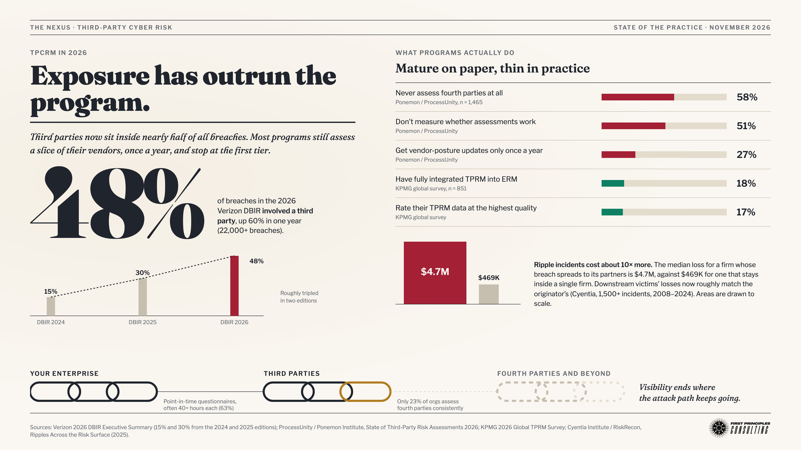

# Tenchi TPCRM Panel: Draft Responses for Rick

**Date:** 2026-11-03
**Question:** The panel moderator for Tenchi Conference 2026 ("TPCRM: The New Era of Inside-Out," [event page](https://luma.com/vvzsmej9)) sent the discussion agenda: six priority questions, three backup questions, and a closing "Cybersecurity First Principles" question for Rick, with co-panelist Ritu's prepared answers included. Draft responses for the questions aimed at me.

Companion to this morning's status report: [`reports/2026-11-03-tpcrm-state-of-the-industry.md`](https://github.com/raceBannon99/The-Nexus/blob/main/reports/2026-11-03-tpcrm-state-of-the-industry.md).

---

## The Answer (Agent Bradlee)

Your lane on this panel is the attack path and the math. Ritu's prepared answers own the governance and process story: inventory, tiering, ownership, contracts, data hygiene, ERM language. They're good, and they leave a clear opening for you, because they stop where your work starts. She says the board should see "exposure" and "data confidence." You can tell them what that looks like as a number. She says programs are "mature on process but still figuring out outcomes." You can say what outcome to measure: the probability of a material loss that starts with a third party, this business cycle.

Three lines carry the whole panel, and every draft below returns to them.

**First: the questionnaire measures the vendor's paperwork, but attackers come through the vendor's access.** The losses of the last two years went through OAuth tokens, SaaS integrations, managed-service credentials, and shared software, not through a supplier failing an annual survey. Salesloft Drift reached more than 700 organizations' Salesforce data with stolen tokens and no exploit. In the MOVEit campaign, 1,690 of roughly 2,095 known victim organizations were hit through a vendor, not directly. Third parties now appear in 48% of breaches in the 2026 Verizon DBIR. The fix is to inventory the trust paths (every token, integration, and non-human identity a vendor holds into your environment) and to watch them continuously.

**Second: dependency is a different risk from compromise.** CrowdStrike's 2024 update and Change Healthcare's 2024 ransomware attack were not control failures that a vendor assessment would have caught. They were single points of failure. That risk is managed with resilience (alternatives, tested exits, recovery), not diligence. Treat it as its own line item.

**Third: give the board a probability, not a color.** Ritu's own example, the third-party heat map that can't survive "how confident are we?", is exactly the case your published work addresses. Start Outside-In with what the industry data says about third-party loss (DBIR frequency, Cyentia's finding that ripple incidents cost about ten times more, $4.7 million median against $469,000). Then adjust Inside-Out for your own dependencies and controls. What the board gets is a range: a chance of losing more than a stated dollar figure, and how much the next investment moves it. The range's own width is the data-confidence metric Ritu is asking for.

Accountability is where your CSO experience matters most. The US is moving that way too. In September the banking agencies proposed replacing their checklist guidance with one built around "the magnitude and likelihood of harm," and one of its four components is explicit residual risk acceptance. In July the Pentagon paused its own third-party assessment requirement for defense contractors, because about 100,000 companies needed audits and only about 100 certified assessors existed. Assessment-driven oversight does not scale, even for the federal government.

On the future, be specific. Over three years, AI agents become the newest third parties: non-human identities holding permissions into your systems, often without anyone approving them. Fourth-party visibility will improve slowly. Today 42% of organizations assess fourth parties at all, and the most likely figure three years out is about half.

Your own prior positions hold throughout: the first principle, Outside-In/Inside-Out forecasting, and resilience over prevention. The panel's title, "The New Era of Inside-Out," is effectively your essay's vocabulary. Use it.

---

## Clarifying Questions (Agent Bradlee, pre-flight)

None asked. Assumptions logged and carried through:
- **"Aimed at me"** means the directed follow-ups (Q1, Q3), the questions where the moderator names Rick (Q2's handoff from Ritu, Q4's accountability angle, Q5 as lead), the "both panelists" question (Q6), and the closing First Principles question. The three backup questions (fourth parties, AI, DORA) list only Ritu's prepared answers, so short optional versions are drafted in case the moderator turns to Rick.
- **Length:** spoken answers of about 60–90 seconds (roughly 150–220 words), each with a 20-second fallback line.
- **Voice:** first person, conversational, Rick's own vocabulary. **No invented personal anecdotes.** Where a story from Rick's own career would land, the draft marks a slot `[YOUR STORY: ...]` and suggests what kind of story fits. Only Rick knows which ones are true and shareable.
- **Coordination:** where Ritu speaks after Rick and "builds on" him, his draft sets up her points without taking them.

---

## What Do We Already Know? (Agent Alexandria, opening)

This morning's engagement covers the factual ground: [`reports/2026-11-03-tpcrm-state-of-the-industry.md`](https://github.com/raceBannon99/The-Nexus/blob/main/reports/2026-11-03-tpcrm-state-of-the-industry.md). The Library now holds its verified numbers as `fact-sheets/tpcrm-2026-baseline-statistics.md` (merged today, PR #55), plus the "Exposure has outrun the program" infographic. Every statistic below comes from that fact sheet unless Sherlock flags it as new.

Also relevant from the Library: the *First Principles Infographic* fact sheet (the five strategies mapped to the first principle), which drives the closing question's answer. Omar Sangurima's review of *Cybersecurity First Principles* is a useful check on how the book's argument reads to a practitioner audience like this one.

Prior reports: `reports/2026-11-02-sao-paulo-brazil-conference-briefing.md` was also conference prep, the second in two days (see Turing). `reports/2026-07-14-cmmc-phase-2-suspension.md` supplies the CMMC numbers.

---

## The Facts (Agent Sherlock)

### Re-verified or new for this engagement
- **MOVEit (Clop, 2023):** Emsisoft's last reported tally was **2,095 organizations and ~62.05 million individuals**. Brett Callow told TechTarget that **1,690 of the 2,098 known victim organizations were compromised via third parties** rather than directly. The two counts (2,095 vs. 2,098) come from the same tally at slightly different times. The ~80% share holds either way. This is an estimate, partly built from Clop's own leak-site claims. It directly supports Ritu's MOVEit line in the fourth-party backup question.
- **Gartner's "50% by 2028" prediction (Ritu's Q1 citation):** Gartner's own March 2026 summit recap states that "by 2028, half of all TPCRM programs will focus on continuous monitoring, allowing CISOs to repurpose due diligence resourcing." The underlying Predicts 2026 report is paywalled and wasn't read. Ritu's citation checks out at the level of Gartner's public summary.
- **DORA:** the European Supervisory Authorities designated the first **critical ICT third-party providers (CTPPs) on 18 November 2025**. Morgan Lewis counts 19, including hyperscale cloud providers. Designation brings them under direct ESA oversight, and as a last resort regulators can require financial entities to suspend use of a provider. The list is updated annually.
- **KPMG figures Ritu cites** (18% full ERM integration, ~53% "mostly," 17% fully reliable data, 71% planning deeper integration, 83% planning to grow partner networks) all match KPMG's public summary. Ritu's "48% see room to collaborate better" is not on the public summary page (the full report is gated), so it's left as hers to cite.

### From this morning's report (verified then)
- **2026 Verizon DBIR:** 48% of breaches involved a third party, up 60% in a year (from 30%, and 15% two editions earlier). "Involved" includes a supplier that only held the data. Only 23% of third parties fully fixed cloud-MFA gaps.
- **Ponemon / ProcessUnity 2026** (n=1,465, vendor-sponsored): average 12 third-party breaches per year; 58% never assess fourth parties (so **42% do**); 23% do so consistently; 51% don't measure assessment effectiveness; 63% say an assessment takes 40+ hours; 27% get vendor-posture updates only annually.
- **Cyentia, *Ripples* 2025:** ripple-event generators' median loss is $4.7M vs. $469.1K single-firm (~10×). Receivers' losses now roughly match generators'.
- **Incidents:** Salesloft Drift (Aug 2025), OAuth tokens to 700+ organizations, no Salesforce exploit. CrowdStrike (Jul 2024), ~$5.4B direct Fortune 500 loss. Change Healthcare (2024), 192.7M people.
- **US regulation:** the banking agencies' Sept 11, 2026 proposal (four components including **residual risk acceptance**; "magnitude and likelihood of harm"; comments due Nov 16 per law-firm summaries). NYDFS non-delegation. CMMC Phase 2 paused Jul 13, 2026 (~100,000 companies, ~100 assessors).
- **SEC Item 106 (Reg S-K):** requires annual disclosure of cyber risk management processes, explicitly including processes to oversee risks from third-party service providers, and board and management oversight. *General coverage of the 2023 rule, not re-fetched today.*
- **US oversight of tech providers (Q-DORA backup):** US bank regulators can already examine significant technology service providers under the Bank Service Company Act, through FFIEC interagency supervision. *Uncited general coverage. Rick should state it only if comfortable.*

### Recent Nexus-logged items Rick can use for the "AI as third party" angle
- Major US banks detecting unsanctioned third-party AI agents acting inside customer accounts, with most unable to tell agent activity from user activity (daily report 2026-10-24, via Axios/SecurityWeek).
- An Accenture contractor allegedly connected a DOD system to a personal AI coding agent, which ran for two months before discovery (Wired, 2026-10-29; disputed by Accenture; single-source).

### First Principles Newsletter Tracker check
- **Thread 1 (the first principle):** Supports. The moderator's closing question invites Rick to apply it to TPCRM directly. Logged 2026-11-03.
- **Thread 2 (heat maps vs. Loss Exceedance Curves; ["Outside-In and Inside-Out Superforecasting"](https://diffuser.substack.com/p/outside-in-and-inside-out-superforecasting)):** Supports. Ritu's own prepared Q2 answer names the heat-map confidence problem. Logged 2026-11-03.
- **Thread 3 (resilience; ["Cyber Resilience"](https://diffuser.substack.com/p/cyber-resilience)):** Supports. Already logged this morning; no second entry.

### Forecast (Sherlock)
Q6 asks Rick to look three years ahead. To give him a concrete, checkable claim, this run forecasts **the share of organizations that assess fourth-party risk at all in a comparable survey around late 2029** (Ponemon/ProcessUnity 2026 baseline: 42%). Sherlock: **about 45% to 62%, median around 52%.** The drivers are regulatory pressure on concentration (DORA, the banking proposal), more vendor-side disclosure clauses, and monitoring tools that now map fourth parties automatically.

**Library candidates:** none new. This engagement draws on the fact sheet already in the Library.

---

## Adversary Playbook (Agent Ryan)

This is panel preparation, not a campaign analysis. No kill chain and no Adversary Tracking Report update. One framing matters for Rick's answers. The campaigns he'll cite share a single adversary preference: **compromise one trusted intermediary to reach many victims.** Salesloft Drift (UNC6395, unattributed, OAuth tokens), MOVEit (Clop, cybercrime, file-transfer zero-day, ~80% of victims reached via vendors), and Storm-0940 against ConnectWise Cloud Backup (China state-aligned per Microsoft, MSP credentials; already tracked) all fit it. For attackers, a third party is a force multiplier. That's why the economics favor going after suppliers, and why defenders' attention should go to integrations and credentials, not questionnaires.

Attribution language for the stage: say "Clop" for MOVEit (self-claimed, widely accepted). Say "an unattributed group Google tracks as UNC6395" for Drift. Say "a China-aligned group, per Microsoft" for ConnectWise. Don't attribute Drift to a nation-state.

**Forecast:** no adversary-specific grounds for a fourth-party-assessment estimate. None stated.

---

## First Principles (Agent Euclid)

What must be true about Rick's role on this panel?

1. **Two panelists with the same answer is a wasted panel.** Ritu's drafts are complete on governance. Rick's value is everything they stop short of: *what the attacker actually does* (trust paths) and *what the board actually needs* (a probability). Every Rick draft should add one of those two things to her point, not restate it.

2. **The first principle gives TPCRM a definition of success.** If the goal is to reduce the probability of a material event within the business cycle, then a third-party program succeeds when that probability falls, not when assessments get completed. That single sentence resolves Ritu's "activity vs. exposure" test (Q4) and her "vanity metrics" point (Q5), and it gives Rick a principled reason for the conclusions she reaches by experience.

3. **The five strategies apply to third parties one-to-one.** Zero trust: every vendor connection is an identity with least privilege. Intrusion kill chain prevention: watch for adversary tradecraft along vendor access paths. Resilience: survive the vendor's failure. Risk forecasting: quantify third-party loss. Automation: you can't do this by spreadsheet across thousands of vendors. That's the closing answer, and it's coherent because it's derived rather than borrowed.

4. **The panel's title is Rick's own method.** "Outside-In and Inside-Out" is how his essays build a forecast. The conference's "New Era of Inside-Out" probably means looking out from inside your own dependencies rather than relying on outside ratings. Either way, the bridge is natural: outside-in data sets the baseline, inside-out knowledge adjusts it.

**Forecast (Euclid):** fourth-party assessment spreads with contract clauses and tooling but stays expensive. Most programs will reach it first "for critical suppliers only," which surveys may or may not count as "yes." **About 44% to 60%, median around 50%.**

---

## How Could We Be Wrong? (Agent Popper)

1. **Rick could come across as contradicting his co-panelist.** Ritu's Q2 answer mentions the heat map. If Rick says "heat maps are bad science" right after her, it can sound like a correction on stage.
2. **Loss Exceedance Curves can sound academic to a TPRM audience.** Few programs can produce one. A panel answer that boils down to "build a Monte Carlo model" may lose the room.
3. **Invented stories are a real risk.** The moderator asks Rick to draw on his Palo Alto Networks and CyberWire experience. A drafted anecdote that didn't happen is worse than no anecdote. It's a credibility landmine on stage.
4. **Accountability (Q4) duplicates Ritu.** She already has "outsource the activity, not the accountability." If Rick restates it, the answer is redundant.
5. **Leaning on vendor-sponsored stats.** The Ponemon figures come from a TPRM software vendor's survey. If a vendor-side audience member pushes back, Rick needs the caveat ready.
6. **The fourth-party forecast may not be measurable.** "Assess fourth parties at all" depends on how a future survey words the question. A three-year forecast on a moving survey item is soft.

**Forecast (Popper):** survey-to-survey wording and sample changes add noise, and the 2026 figure may itself be inflated by "only for critical suppliers" answers counting as yes. **About 38% to 58%, median around 47%.**

---

## Resolution (Agent Seldon)

1. **Contradicting Ritu: resolved by structure.** Every Rick draft opens by agreeing with or extending her point, then sharpens it. On the heat map specifically (Q2), Rick takes her own example as the setup ("Ritu put her finger on it...") rather than correcting it.
2. **Too academic: resolved.** The drafts never say "Monte Carlo" or "lognormal." They say "a range with a dollar figure," with a one-sentence version a board member could repeat. The method stays available if the moderator follows up.
3. **Invented stories: accepted in full.** Every place an anecdote would land is a marked `[YOUR STORY: ...]` slot with a suggestion of what kind of story fits. No experience is attributed to Rick that he hasn't supplied.
4. **Q4 duplication: resolved.** Rick's Q4 draft skips the slogan and goes to what accountability means operationally: a named risk owner, an explicit residual-risk signature, and CMMC as the example of assessment-based accountability failing to scale.
5. **Vendor-sponsored stats: accepted.** Each draft prefers Verizon, KPMG, Cyentia, and incident data. Ponemon numbers appear only where nothing else measures the point (fourth-party assessment), with the source named so Rick can caveat it.
6. **Forecast measurability: partly accepted.** The forecast is stated as a survey-share range with an explicit caveat, and Rick's Q6 draft uses it as a direction ("about half"), not as a precise claim.

### Forecast: share of organizations assessing fourth-party risk at all, comparable survey ~late 2029 (2026 baseline: 42%)

| Stage | Estimate (low – high, median) | Reasoning |
|---|---|---|
| Sherlock | ~45% – 62%, median ~52% | Regulatory concentration pressure, contract clauses, automated mapping tools |
| Ryan | none | No adversary-specific grounds |
| Euclid | ~44% – 60%, median ~50% | Spreads "critical suppliers only" first; stays expensive |
| Popper | ~38% – 58%, median ~47% | Survey wording and sample noise; baseline may be inflated |

**Agreement:** everyone expects improvement from 42%. No one expects a majority doing it consistently (today 23%).
**Divergence:** the low end. Popper allows that measured adoption could barely move or slip on survey noise alone.
**Submitted call:** the range runs from about **40% to 60%**, a 20-point span, with a median around **50%**, about 10 points above the low end. Popper's measurement objection pulls the low end below the 42% baseline. The high end is held near 60% because the cost of fourth-party work hasn't dropped much yet. **This is reasoned judgment anchored to one survey's baseline, not a model.**

---

## The Drafts (Agent Tufte, formatting)

No new diagram this time. The deliverable is spoken answers, and spatial layout wouldn't add anything a lane table can't carry. The morning's infographic is ready if the moderator puts up slides:

### Who covers what

| Question | Ritu's lane (prepared) | Rick's lane (drafted below) |
|---|---|---|
| Q1 maturity | Process mature; gaps: front-loaded, dependencies, ownership | **Goes first.** Attackers come through vendor *access*, not paperwork; compromise vs. dependency |
| Q2 ERM & data | Same language as ERM; fix data; event-driven | **Answers her handoff.** Yes, and the translation layer is a probability, not a heat map |
| Q3 SOC 2 / questionnaires | Necessary not sufficient; baseline + signals + tiering | **Goes first.** Confidence in the vendor, never in the connection; what he wanted to see |
| Q4 accountability | Can't outsource accountability; regulation as floor | Accountability in practice: named owner, signed residual risk, CMMC scaling lesson |
| Q5 board communication | Exposure, coverage, issues, resilience; retire vanity metrics | **Leads.** One number, its trend, and what moves it |
| Q6 three years out | Continuous default; TPRM into resilience; AI both sides | AI agents as the new third party; quantification goes mainstream; fourth-party forecast |
| First Principles | n/a | The five strategies applied to third parties |

---

### Q1 follow-up: recurring gaps you've seen (Rick goes first; Ritu builds on it)

> Here's the gap I keep running into, and it's a strange one: we've built very good programs for assessing the *company*, and we mostly ignore the *connection*.
>
> We send the questionnaire, we get the SOC 2, we score the vendor. But that's not how attackers come in. They come in through the access we gave the vendor. The OAuth token. The API key. The managed-service account with domain admin. Salesloft Drift last year reached more than 700 organizations' Salesforce data with stolen tokens. Nobody exploited Salesforce. Nobody failed a questionnaire.
>
> [YOUR STORY: a moment at Palo Alto Networks or The CyberWire when a vendor looked fine on paper but the real exposure was an integration, an account, or a dependency nobody had mapped. Thirty seconds, concrete.]
>
> The second gap is lumping two different risks together. There's the risk that a vendor gets *breached*, and there's the risk that a vendor goes *down*. CrowdStrike in 2024 and Change Healthcare weren't questionnaire failures. They were single points of failure. One is a security problem, the other is a resilience problem, and most programs manage both with the same spreadsheet.
>
> Meanwhile the 2026 Verizon DBIR has a third party involved in 48% of breaches, up 60% in a year. So the exposure is moving faster than the programs.

**20-second fallback:** "We're good at assessing the vendor and bad at watching the connection. Attackers come in through the tokens and accounts we hand vendors, not through a failed questionnaire. And we lump 'vendor gets breached' together with 'vendor goes down,' which are two different problems."

**Sets up Ritu:** her "front-loaded" and "dependency visibility" gaps land naturally after this. Don't take her "ownership" point.

---

### Q2 handoff: "security often has the freshest data but the weakest line into ERM. Is that fair?"

> That's fair, and I'd say it's a translation problem, not a data problem. Security talks in vulnerabilities, scores, and findings. ERM talks in impact and likelihood. The board talks in dollars. Nobody's translating.
>
> And Ritu put her finger on the exact failure point: the heat map. When the board asks "how confident are we?" and the honest answer is "not very," that's because a red box on a heat map doesn't carry any confidence. It's a color.
>
> What works is to state third-party risk the way you'd state any business risk: a probability and a dollar figure. Something like "there's roughly a one-in-X chance this year that a vendor incident costs us more than $Y, and here's how the next investment changes that." You start Outside-In, from what the industry data says about third-party losses. Verizon has third parties in nearly half of breaches. Cyentia finds incidents that ripple across companies cost about ten times more than ones that don't. Then you adjust Inside-Out for your own vendors and controls.
>
> Here's the nice part for Ritu's data-confidence point. A range has the confidence built in. If your data's bad, your range is wide, and you show the board that. Fixing the data is what narrows it.

**20-second fallback:** "Fair. It's translation. The board speaks dollars, and a heat map can't answer 'how confident are we.' Give them a range, a probability of losing more than a stated amount, and the width of that range *is* your confidence."

**Note:** use "one-in-X" and "$Y" as the shape, or a real number from a prior employer's model if you can share one. Don't invent figures on stage.

---

### Q3 follow-up: how much confidence in traditional supplier assessments? What did you want to see? (Rick first; Ritu builds)

> Honest answer? I had a fair amount of confidence in what those documents said, and almost none in whether they answered my question.
>
> A SOC 2 tells me the vendor had controls, in scope, during an audit window. My question was different: if this vendor gets compromised tomorrow, what can the attacker reach in *my* environment, and how fast will I know?
>
> [YOUR STORY: a decision as CSO or CISO where the assessment came back clean and you still had to make the call on something it didn't cover, like an integration's permissions, a subcontractor, or notification timing.]
>
> What I wanted to see was three things. One, what the vendor's access actually is: every account, token, and integration they hold into our systems, and what each one can touch. Two, how quickly they'd tell me if something went wrong, as a measured fact, not a contract promise. The 2026 DBIR found only 23% of third parties fully fixed missing MFA on their cloud accounts, and the slow fixes took months. Three, what breaks if they disappear, meaning how replaceable they are.
>
> Notice that none of those three is in a SOC 2.

**20-second fallback:** "Confident in what they said, not that they answered my question. I didn't need to know whether the vendor had controls. I needed to know what they could reach in my environment, how fast they'd tell me, and what breaks without them."

**Sets up Ritu:** her "context: same SOC 2, different risk" is the perfect follow-on to "notice that none of those three is in a SOC 2."

---

### Q4: accountability in practice for security leaders (Rick's angle; Ritu takes governance)

> Ritu's right that you can't outsource accountability. Let me say what that means on a Tuesday afternoon for a security leader.
>
> It means every critical vendor has a named person who signs the residual risk. Not "the program approved it." A person, usually the business owner, with the CISO's assessment in front of them, saying "I accept this risk at this level." The federal banking agencies' September proposal names that step outright: residual risk acceptance is one of its four components. That's the shift from checklist to accountability.
>
> It also means being honest about what assessments can carry. In July the Pentagon paused the requirement that defense contractors pass a third-party CMMC assessment. Roughly 100,000 companies needed one and there were about 100 certified assessors. If the federal government can't make assessment-based accountability scale, your team of four probably can't either.
>
> So the accountable security leader stops promising "every vendor assessed" and starts promising "every critical vendor's risk owned, monitored, and survivable."

**20-second fallback:** "Accountability means a named person signs the residual risk for every critical vendor, and the banking agencies' new proposal says so. Assessment doesn't scale: the Pentagon just paused CMMC third-party audits, with about 100,000 companies needing one and about 100 assessors to do them."

**Optional follow-up (subcontractors), if it comes to Rick:** "Ritu's concentration point is the right one. Here's the number that proves it: in MOVEit, about 1,690 of roughly 2,100 known victim organizations were hit through a vendor, not directly. That's about eighty percent. Ask which underlying provider ten of your suppliers share, not who your supplier's supplier is."

---

### Q5: how CISOs should communicate third-party risk to boards (Rick leads; Ritu follows with her four)

> I'd start by taking something off the slide: the heat map, and every count of activity. Assessments completed, questionnaires returned, suppliers approved. Those tell the board the team was busy. They don't tell the board whether the company is safer.
>
> The board's job is to decide how much risk to accept and what to spend. So give them three things they can decide on.
>
> First, one number: the probability that a third party causes a material loss this year, meaning over a dollar figure the board itself has called material. Stated as a range, because it is one.
>
> Second, the trend: is that number going up or down, and why? New vendors, new integrations, an AI agent the business plugged in last quarter.
>
> Third, the price of moving it: "if we fund this, the probability drops from about this to about that." That's a business decision, and it's the conversation they want.
>
> Under that, I'd keep a couple of leading indicators the board can sanity-check. How long it takes us to learn a critical vendor has an incident. And whether we've actually rehearsed losing our top vendors, as opposed to just writing the plan.
>
> [YOUR STORY, optional: how a board or exec team reacted the first time you gave them a probability instead of a color.]

**20-second fallback:** "Retire the heat map and the activity counts. Give the board one number, the chance a vendor causes a material loss this year, plus its trend and what it costs to move it. That's a decision they can actually make."

**Sets up Ritu:** her four (exposure, coverage, issues, resilience) become the supporting dashboard under your one number. That's a clean handoff: "Ritu's four are how you *produce* that number."

---

### Q6: the next three years (both panelists)

> Three predictions, and I'll put numbers on one of them.
>
> One: the newest third parties won't be companies. They'll be AI agents: software with credentials, acting inside your systems, often connected by someone in the business without anyone approving it. The big banks are already seeing third-party AI agents operating inside customer accounts and can't tell agent activity from customer activity. TPCRM will have to cover non-human identities, not just vendors.
>
> Two: quantification goes mainstream, because the regulators are moving that way. The banking agencies now talk about "the magnitude and likelihood of harm." That's a probability-times-impact sentence. Programs that can only produce a color will struggle to answer it.
>
> Three, the one with a number: fourth-party visibility improves, but slowly. Today about 42% of organizations assess fourth-party risk at all. Three years from now my estimate is about half, somewhere between 40% and 60%. Better, not solved, which is why Ritu's concentration point matters so much.
>
> What to do now: inventory every token, integration, and service account a vendor holds into your crown jewels. That's your real third-party attack surface, and most companies don't have that list.

**20-second fallback:** "AI agents become the newest third parties. Quantification goes mainstream because regulators now ask for magnitude and likelihood. Fourth-party visibility goes from about 42% to about half. Start today by listing every vendor token and integration touching your crown jewels."

**Coordination:** Ritu also has "AI on both sides." Rick's version is specifically *agents as identities*. Hers is supplier AI adoption and AI-assisted triage. If Rick goes second, open with "Building on Ritu's AI point..."

---

### Closing: "If you were building a TPCRM program from scratch, which principles would you prioritize?"

> I'd start where I start everything: with the first principle. The goal of a security program is to reduce the probability of a material cyber event within the business cycle. So a third-party program succeeds when that probability goes down. That's it. It doesn't succeed when assessments get done.
>
> Then I'd run the five strategies I'd use for any program, pointed at third parties.
>
> **Zero trust:** every vendor connection is an identity with least privilege. No standing admin, scoped tokens, and access you can revoke in minutes.
>
> **Intrusion kill chain prevention:** watch the vendor access paths for adversary behavior, the way you'd watch your own network. Attackers love a trusted intermediary because it's one compromise for many victims.
>
> **Resilience:** assume a critical vendor will fail or get breached, and rehearse it. CrowdStrike and Change Healthcare were resilience tests, not assessment failures.
>
> **Risk forecasting:** Outside-In, Inside-Out. Start with industry data on third-party losses and adjust for your own vendors. Report a probability and a dollar figure.
>
> **Automation:** you can't do any of this by spreadsheet across thousands of vendors, so automate the inventory and the monitoring.
>
> What would I do differently? I'd tier vendors by blast radius, not by spend. A twenty-thousand-dollar plug-in with a read token to your CRM can matter more than a two-million-dollar facilities contract.

**20-second fallback:** "Start with the first principle: reduce the probability of a material event. Tier vendors by blast radius, not spend. Treat every vendor connection as a zero-trust identity. Rehearse vendor failure. Report a probability, not a grade."

---

### Backup questions, in case the moderator turns to Rick

**Fourth and fifth parties:** use the MOVEit line from Q4's optional follow-up (~1,690 of ~2,100 known victim organizations hit via a vendor), then: "The question isn't who your supplier's supplier is. It's which single provider ten of your suppliers share."

**AI and third-party risk:** "Ritu's covered supplier AI well. I'd add one thing: an AI agent is a third party with a password. When someone connects an agent to a system, they've onboarded a vendor without procurement, legal, or security ever seeing it. Most TPRM programs have no intake for that."

**DORA vs. the US:** "Agree with Ritu: different road, similar destination. One concrete difference: last November European regulators formally designated 19 critical tech providers, hyperscale clouds among them, for direct oversight. The US doesn't have that kind of designation regime for cloud concentration. Our bank regulators can examine significant tech service providers, but nobody has publicly said 'these few clouds are critical to the whole sector, and we're supervising them.' That's the gap I'd watch." *(Say the Bank Service Company Act part only if you're comfortable with it. See Sherlock's note.)*

### Numbers card (all verified unless marked)
- 48%: share of breaches involving a third party, 2026 Verizon DBIR (up 60% in a year)
- 700+: organizations reached by Salesloft Drift via stolen OAuth tokens
- ~1,690 of ~2,100: MOVEit victim organizations hit through a vendor (Emsisoft estimate, via TechTarget)
- ~10×: ripple-incident median loss vs. single-firm ($4.7M vs. $469K, Cyentia)
- 23%: third parties that fully fixed cloud-MFA gaps (DBIR)
- 42% assess fourth parties at all; 23% consistently (Ponemon/ProcessUnity, vendor-sponsored)
- ~100,000 companies, ~100 assessors: CMMC Phase 2 pause, July 2026
- Sept 11, 2026: banking agencies' proposal ("magnitude and likelihood of harm," residual risk acceptance)
- Forecast: fourth-party assessment ~40–60% by ~2029, median ~50%

---

## Sources

### Carried from this morning's report (verified there)
- [Verizon 2026 DBIR Executive Summary](https://www.verizon.com/business/resources/executivebriefs/2026-dbir-executive-summary.pdf): 48%, +60%, 23% MFA remediation.
- [Ponemon / ProcessUnity, State of Third-Party Risk Assessments 2026](https://info.processunity.com/rs/638-QKL-150/images/Report-ProcessUnity-State-of-Third-Party-Risk-Assessments-2026.pdf): fourth-party (58% / 42%, 23%), effectiveness, effort. Vendor-sponsored.
- [KPMG 2026 Global TPRM Survey](https://kpmg.com/us/en/articles/2026/global-third-party-risk-management-survey.html): 18% / ~53% ERM integration, 17% data, 71%, 83%.
- [Cyentia / RiskRecon, Ripples Across the Risk Surface 2025](https://www.cyentia.com/publication/2025-ripples-across-the-risk-surface/): ~10× ripple losses.
- [FINRA on Salesloft Drift](https://www.finra.org/rules-guidance/guidance/salesloft-drift-AI-supply-chain-attack): OAuth tokens, 700+ organizations (count per Expert Insights/TechTarget coverage in the morning report).
- [Axios on Parametrix](https://www.axios.com/2024/07/24/fortune-500-crowdstrike-outage-impact): CrowdStrike $5.4B. [Becker's](https://www.beckershospitalreview.com/healthcare-information-technology/cybersecurity/change-healthcare-data-breach-toll-reaches-192-7-million): Change Healthcare 192.7M.
- [OCC Bulletin 2026-46](https://occ.gov/news-issuances/bulletins/2026/bulletin-2026-46.html) and [Crowell analysis](https://www.crowell.com/en/insights/client-alerts/from-process-to-principles-federal-regulators-propose-a-new-third-party-risk-management-framework): four components including residual risk acceptance.

### New this engagement
- [TechTarget, "Clop MoveIt Transfer attacks affect over 2,000 organizations"](https://www.techtarget.com/searchsecurity/news/366553304/Clop-MoveIt-Transfer-attacks-affect-over-2000-organizations): Emsisoft tally (2,095 organizations / ~62.05M individuals); 1,690 of 2,098 via third parties.
- [Gartner, Security & Risk Management Summit 2026 India, Day 2 highlights](https://www.gartner.com/en/newsroom/press-releases/2026-03-10-gartner-security-and-risk-management-summit-2026-india-day-2-highlights): "by 2028, half of all TPCRM programs will focus on continuous monitoring." Verifies Ritu's Q1 citation at the public-summary level.
- [ESMA, ESAs designate critical ICT third-party providers](https://www.esma.europa.eu/press-news/esma-news/european-supervisory-authorities-designate-critical-ict-third-party-providers) and [Morgan Lewis](https://www.morganlewis.com/de/blogs/sourcingatmorganlewis/2025/11/dora-eu-regulators-announce-list-of-critical-ict-third-party-providers): DORA CTPP designation, Nov 18, 2025; 19 providers.
- **SEC Item 106 third-party oversight disclosure; Bank Service Company Act examination authority:** uncited general coverage.

### Internal precedent
- [`reports/2026-11-03-tpcrm-state-of-the-industry.md`](https://github.com/raceBannon99/The-Nexus/blob/main/reports/2026-11-03-tpcrm-state-of-the-industry.md): this morning's status report.
- `reports/2026-07-14-cmmc-phase-2-suspension.md`: CMMC numbers.
- Daily reports of 2026-10-24 (third-party AI agents in bank accounts) and 2026-10-30 (Accenture/DOD AI-agent incident, disputed).
- Alexandria's Library: `fact-sheets/tpcrm-2026-baseline-statistics.md`, `fact-sheets/first-principles-infographic.png`.

### Rick Howard's First Principles Newsletter (tracked theses)
- ["The First Principle of Cybersecurity"](https://diffuser.substack.com/p/the-first-principle-of-cybersecurity) (Thread 1): the closing answer's foundation.
- ["Outside-In and Inside-Out Superforecasting"](https://diffuser.substack.com/p/outside-in-and-inside-out-superforecasting) and ["A Board Presentation on Cyber First Principles"](https://diffuser.substack.com/p/a-board-presentation-on-cyber-first) (Thread 2): Q2 and Q5.
- ["Cyber Resilience"](https://diffuser.substack.com/p/cyber-resilience) (Thread 3): the dependency-vs-compromise distinction.

### Event
- [Tenchi Conference 2026, "TPCRM: The New Era of Inside-Out"](https://luma.com/vvzsmej9)

---

## New Skills (Agent Turing)

None built, but flagged. This is the second conference-prep engagement in two days (São Paulo briefing yesterday, this panel today), and the shape repeats: take the moderator's agenda, split lanes with co-panelists, draft spoken answers in Rick's voice with fallback lines, mark anecdote slots instead of inventing them, and add a numbers card. If a third panel-prep run happens, it's worth turning into a `nexus-panel-prep` skill. Building it on two examples would lock in choices not yet proven.

---

## Library Recommendations (Agent Alexandria, closing)

Nothing new recommended. The facts this engagement relies on are already in the Library (`fact-sheets/tpcrm-2026-baseline-statistics.md`, merged today). The drafts themselves are Rick's personal speaking notes, specific to one panel and one co-panelist, so they aren't reusable reference material. One small candidate is noted but not recommended: the MOVEit third-party share (~1,690 of ~2,100) could be appended to the TPCRM fact sheet in a future update if third-party questions keep recurring.

---

## Number Check (Agent Popper, second pass)

- **48% / +60%:** synthesis, Q1, and the numbers card match the DBIR ✓.
- **MOVEit:** the synthesis says "1,690 of roughly 2,095." Q4's follow-up and the numbers card say "~1,690 of ~2,100." Sherlock's section explains the 2,095 vs. 2,098 tally difference. 1,690 / 2,095 = 80.7% and 1,690 / 2,098 = 80.6%, both "about eighty percent" ✓. Wording is consistent ("roughly / ~"). No mismatch.
- **Salesloft 700+, CrowdStrike $5.4B, Change Healthcare 192.7M, Cyentia $4.7M vs. $469K (~10×), 23% MFA:** consistent with the morning report and fact sheet ✓.
- **Fourth-party:** 58% don't, so 42% do ✓. 23% consistently ✓. Used as 42% in the synthesis, Q6, the numbers card, and the forecast table ✓.
- **Forecast:** 40%–60%, median 50%. Span 60 − 40 = 20 points, median 50 − 40 = 10 points above the low end. Consistent in Seldon's section, Q6, the numbers card, and the synthesis ("about half") ✓.
- **CMMC:** ~100,000 / ~100, July. Consistent in the synthesis, Q4, and the numbers card ✓.
- **DORA:** 19 providers, Nov 18, 2025 ("last November" relative to 2026-11-03) ✓.
- **KPMG:** 18% / ~53% / 17% / 71% / 83% consistent with the morning report ✓.
- **Q1 "48%, up 60% in a year":** ✓. Q3 "23%": ✓.
- **No mismatches found.** Nothing was sent back.
