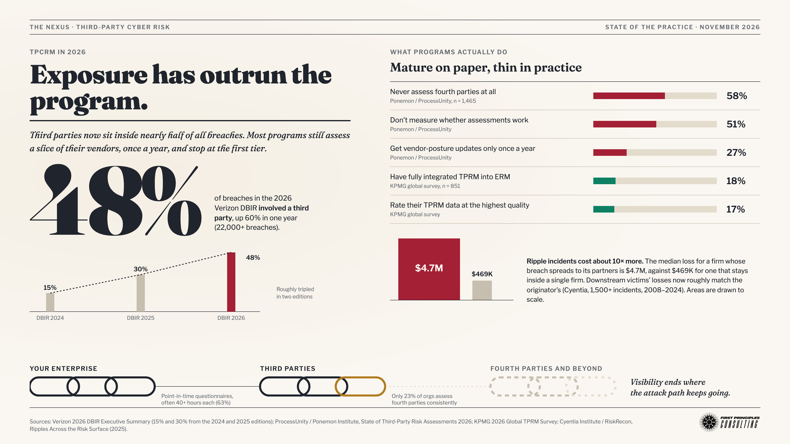

# The State of Third-Party Cyber Risk Management (TPCRM), November 2026

**Date:** 2026-11-03
**Question:** I'm on a panel tomorrow at Tenchi Conference 2026 – 4th Edition, "TPCRM: The New Era of Inside-Out" ([event page](https://luma.com/vvzsmej9)). The panel will explore the evolution of Third-Party Cyber Risk Management in the United States: current market maturity, persistent gaps in traditional assessment approaches, the growing need for continuous visibility into third-party security posture and business dependencies, moving beyond periodic assessments toward a continuous, risk-based approach, strengthening oversight and accountability, integrating TPCRM into Enterprise Risk Management (ERM), and giving leadership teams and boards meaningful information for business decisions. What's the current status of Third-Party Cyber Risk Management (TPCRM) in the industry today?

---

## The Answer (Agent Bradlee)

Third-party cyber risk management in the United States has become universal and is still immature. Nearly every large organization runs a program, and regulators expect one. Most of those programs measure their vendors' paperwork, not their vendors' exposure. Meanwhile, third parties now appear in almost half of all data breaches.

The 2026 Verizon Data Breach Investigations Report, covering more than 22,000 confirmed breaches, found a third party involved in 48% of them. That is up 60% in a single year. Two editions earlier the figure was 15%. Part of that rise reflects how Verizon codes a breach: it counts both a supplier that served as the entry point and a supplier that simply held the stolen data. The direction is still real. Independent datasets show the same thing. Practitioners surveyed by the Ponemon Institute report an average of 12 third-party breaches a year, and roughly nine in ten had at least one.

The programs have not kept pace. In the same Ponemon survey of 1,465 practitioners, 58% never assess their vendors' own suppliers, the so-called fourth parties. Half do not measure whether their assessments work at all. More than a quarter receive updates on a vendor's security posture only once a year. Assessments routinely take more than 40 hours each and four months or longer to finish, which means the snapshot is stale before it is filed. KPMG's 2026 global survey found only 18% of programs fully integrated with enterprise risk management, and only 17% that rate their underlying data at the highest quality.

The questionnaire fails because it answers the wrong question. A vendor attestation describes controls at one moment. The losses of the last two years came through two different channels, and the questionnaire misses both. The first is the trust path: OAuth tokens and SaaS integrations, as in the 2025 Salesloft Drift campaign that reached more than 700 organizations' Salesforce data without touching Salesforce itself. The second is dependency concentration. CrowdStrike's faulty 2024 update cost the Fortune 500 an estimated $5.4 billion in direct losses, and Change Healthcare's 2024 ransomware attack exposed 192.7 million people's records and froze claims processing for much of US healthcare. Neither event was a control failure that a vendor survey would have caught. When a breach does ripple outward, it costs about ten times more than a contained one: a $4.7 million median loss against $469,000.

The industry is moving, slowly, in the direction the panel's title suggests. The federal banking agencies proposed in September to replace their 2023 third-party guidance with a shorter framework focused on "the magnitude and likelihood of harm" rather than checklists. New York's financial regulator has told covered firms they cannot delegate responsibility for a vendor's security. The Pentagon, meanwhile, paused its own independent assessment requirement for defense contractors in July: about 100,000 companies needed audits and only about 100 certified assessors existed. Point-in-time assessment does not scale, even for the federal government. Continuous outside-in monitoring is now common, but most of it still reports letter grades and color scores, which is the old heat map in a new costume.

Your own prior position holds and is the right frame for the panel. Your "Outside-In and Inside-Out" method answers what the market lacks: an industry baseline for third-party loss, adjusted for the organization's own dependencies and controls and expressed as a probability of material loss, which is the language a board can act on. Expect the problem to get worse before programs catch up. Next year's Verizon report will most likely show third-party involvement between about 38% and 60% of breaches, with a median near 50%.

---

## Clarifying Questions (Agent Bradlee, pre-flight)

None asked. The question is well scoped: it names the panel, the topics, and the deliverable (a current-status read). Assumptions logged and carried through the run:

- **"Today"** means as of 2026-11-03, using the most recent published data (2026 DBIR, 2026 KPMG and Ponemon surveys, September 2026 regulatory proposals).
- **"United States"** is the focus, but most good TPCRM datasets are global. Where only global data exists it is used and labeled as global. Where a US cut exists (SecurityScorecard's 2025 report) it is reported alongside.
- **Format** is tuned to panel prep: a defensible status read, the strongest numbers, and the honest caveats a fellow panelist or moderator might raise.

---

## What Do We Already Know? (Agent Alexandria, opening)

**Artifact library (`raceBannon99/nexus-artifacts`):** nothing specific to third-party risk. Two entries bear on the framing. The *First Principles Infographic* fact sheet maps capabilities to the "reduce the probability of a material impact over the next business cycle" thesis, and Omar Sangurima's review of *Cybersecurity First Principles* summarizes the book's risk-forecasting chapter. Both apply to the "give boards meaningful information" half of the panel brief. No open artifact PRs pending.

**Prior Nexus reports (`raceBannon99/The-Nexus`):** no prior engagement on TPCRM. Three are relevant precedent:
- `reports/2026-07-14-cmmc-phase-2-suspension.md`: the Department of War's suspension of CMMC Phase 2 third-party assessments, a direct US data point on assessment capacity (added in the same-day Update Pass, see Update Notes).
- `reports/2026-09-30-shinyhunters-fbi-kill-chain.md`: concluded that an agency's real attack surface is the third-party commercial software it exposes, the same trust-path point made here (added in the Update Pass).
- `reports/2026-07-22-resilience-vendor-landscape.md`: the resilience side of vendor dependency.
- `reports/2026-08-16-cybersecurity-risk-heatmap-origin.md`: the history of the ordinal heat map, which most security-ratings products still effectively reproduce.
- Recent daily reports logged third-party incidents directly: the Storm-0940 ConnectWise Cloud Backup supply-chain breach (2026-10-23), major US banks detecting unsanctioned third-party AI agents inside customer accounts (2026-10-24), and an Accenture contractor allegedly connecting a DOD system to a personal AI coding agent (2026-10-30, disputed by Accenture). All are already tracked in the Adversary Tracking Report or the First Principles Newsletter Tracker.

The Sources section starts here and builds through the run (see below).

---

## The Facts (Agent Sherlock)

### Exposure: how often third parties are in the breach

- **Verizon 2026 DBIR** (31,000+ incidents, 22,000+ confirmed breaches, 145 countries): breaches with third-party involvement "increased by 60% from last year's dataset, reaching 48% of total breaches." Verified against Verizon's executive summary PDF. The prior edition (2025 DBIR) put the share at 30%, doubled from 15% in the 2024 edition. **Coding caveat:** DBIR's third-party flag covers both a supplier as the entry point and a supplier that held the breached data, so "involvement" is not "caused by."
- The 2026 DBIR also found that only **23%** of third-party organizations fully remediated missing or improperly secured MFA on their cloud accounts. For weak passwords and permission misconfigurations, resolving half the findings took **almost eight months**. Exploitation of vulnerabilities is now the top initial access vector at **31%**, and ransomware appears in **48%** of breaches.
- **SecurityScorecard 2025 Global Third-Party Breach Report** (1,000 breaches, 2024 data): **35.5%** of breaches were third-party related. The **US rate was 30.9%**, below the global figure. Vendor-published.
- **Ponemon Institute / ProcessUnity, State of Third-Party Risk Assessments 2026** (1,465 practitioners): respondents report an average of **12 third-party breaches per year**. **89%** of large and **92%** of small organizations had at least one in the past year. Vendor-sponsored (ProcessUnity sells TPRM software).
- **Gartner (December 2023, n=376):** **45%** of organizations experienced third-party-related business interruptions in the prior two years despite rising TPCRM spend. This is the most recent Gartner figure found; no 2025–2026 update surfaced.

### Cost: why third-party incidents are different

- **Cyentia Institute / RiskRecon, *Ripples Across the Risk Surface* (2025)** (1,500+ multi-party incidents, 12,000+ receiving firms, 2008–2024): firms that generate a ripple event take a **median loss of $4.7M, about 10× the $469.1K** for single-firm incidents. At the 95th percentile it is **$371.0M versus $26.5M (14×)**. Downstream receivers' per-firm losses "now roughly match those of generators." Organizations with $10B+ in revenue are about **twice as likely** to generate and receive ripples.
- **Concentration-risk events:** CrowdStrike's July 2024 faulty update cost US Fortune 500 companies (excluding Microsoft) an estimated **$5.4B** in direct losses, with about one in four disrupted (Parametrix, via Axios). The Change Healthcare ransomware attack (2024) ultimately affected **192.7 million** people (HHS OCR breach portal, via Becker's), and Change paid a **$22M** ransom.

### Recent campaigns that define the problem (detail in Ryan's section)

- **Salesloft Drift (August 2025):** stolen OAuth tokens from the Drift chatbot integration reached Salesforce data at **700+ organizations**, including several security vendors, with no Salesforce vulnerability exploited.
- **2026 pattern, secondary sources only:** the Klue market-intelligence SaaS breach (June 2026, OAuth token theft, ~200 organizations per vendor-blog reporting); the Marquis Software breach affecting dozens of financial institutions (August 2026); and PwC's third-party learning-records host incident (October 2026, claimed by Everest). These are treated as illustrative, not load-bearing; they come from aggregators and vendor blogs, not primary disclosures.

### Program maturity: what organizations actually do

**Ponemon / ProcessUnity 2026** (verified against the report PDF):
- **53%** believe their TPRM programs are effective, and **66%** of large versus **40%** of small organizations rate their assessments effective.
- **51%** don't measure the effectiveness of their assessments at all.
- **63%** say a single assessment takes **more than 40 hours** over multiple months, and **64%** of large organizations report a **four-plus-month** assessment cycle.
- **58%** do not assess fourth-party (subcontractor) risk at all. Only **23%** do so consistently, and **38%** report no or slight confidence in fourth-party visibility.
- **27%** receive vendor-posture updates only annually. **18%** don't use continuous monitoring to supplement point-in-time assessments.

**KPMG 2026 Global TPRM Survey** (851 organizations; full report gated, figures from KPMG's public summary):
- Only **17%** report the highest level of data quality.
- **53%** say TPRM is "mostly integrated" with ERM; only **18%** have full integration. **71%** plan further integration.
- **Over 80%** use managed services, outsourcing, or both for core TPRM activities; only **5%** have end-to-end managed models.
- Top drivers: regulatory compliance (**48%**) and cyber risk (**37%**).
- AI use: 50–58% claim to use AI in TPRM, but only **22%** find it "very effective."

### US regulatory direction

- **Federal banking agencies (OCC, Fed, FDIC, and for the first time NCUA), September 11, 2026:** proposed guidance to rescind and replace the June 2023 Interagency Guidance on Third-Party Relationships. It organizes TPRM into four components (risk identification and assessment, risk oversight, residual risk acceptance, governance), moves "away from broad labels and toward the magnitude and likelihood of harm," lightens diligence for low-risk vendors, and is expressly non-binding (OCC Bulletin 2026-46). Law-firm summaries report comments due **November 16, 2026**.
- **NYDFS Part 500:** an October 2025 industry letter on third-party service provider risk (cloud, file transfer, AI, fintech) stresses that covered entities may not delegate Part 500 compliance responsibility to a provider. A **September 10, 2026** letter on risk assessments expects explicit evaluation of third-party service-provider risk.
- **SEC 2023 cyber disclosure rule:** still in force. No 2026 amendments found. Materiality-based incident disclosure applies whether the incident started at a vendor or not, which is why third-party incidents now surface in 8-K filings.
- **CMMC Phase 2 suspended (July 13, 2026):** per the Nexus's own `reports/2026-07-14-cmmc-phase-2-suspension.md` (sourced to the Department of War's release, trade press, and law-firm alerts), the Department of War paused the requirement that defense contractors pass an independent third-party (C3PAO) Level 2 assessment, which was set to bind from November 10, 2026. Stated reason: roughly **100,000+** Defense Industrial Base companies would need assessments, with only about **100** certified assessors. The underlying NIST SP 800-171 controls, self-attestation, and False Claims Act liability remain. This is the largest US government third-party assessment program, and it stalled on exactly the capacity problem the private-sector surveys describe.

### First Principles Newsletter Tracker check

Two standing theses bear directly on this question. Both now have Evidence Log entries dated 2026-11-03:
- **Thread 2: Heat maps are bad science; quantitative forecasting (Loss Exceedance Curves) is the answer.** Includes ["Outside-In and Inside-Out Superforecasting"](https://diffuser.substack.com/p/outside-in-and-inside-out-superforecasting) and ["A Board Presentation on Cyber First Principles"](https://diffuser.substack.com/p/a-board-presentation-on-cyber-first). **Supports.** The panel's own "Inside-Out" framing, the banking agencies' "magnitude and likelihood of harm" language, and KPMG's ERM-integration gap all point toward this thread's prescription. The market's dominant "continuous" tools still report ordinal grades, which is the exact problem the thread diagnoses.
- **Thread 3: Resilience, not prevention, is the affordable strategy** (["Cyber Resilience"](https://diffuser.substack.com/p/cyber-resilience)). **Supports.** Concentration events (CrowdStrike, Change Healthcare) are dependency failures that a questionnaire can't prevent and only continuity planning mitigates.
- **Thread 1** (the first principle itself, ["The First Principle of Cybersecurity"](https://diffuser.substack.com/p/the-first-principle-of-cybersecurity)) supplies the board-level question: what is the probability of a *material* loss from third parties this business cycle? It is referenced but has no new log entry, since nothing found today tests it.
- **Standalone ["SBOM Reliability"](https://diffuser.substack.com/p/sbom-reliability)** (June 2025, SBOM tooling 5–10 years from maturity) bears on software-supply-chain visibility. Nothing found today moves it, so no entry.

### Forecast (Sherlock)

To give the panel a forward-looking anchor, this run forecasts **the share of breaches with third-party involvement in the 2027 Verizon DBIR** (dataset roughly November 2025 – October 2026). Sherlock's estimate: **about 40% to 62%, median around 52%.** The 2026 campaigns logged above (OAuth/SaaS token theft, open-source package compromises such as TeamPCP/"Mini Shai-Hulud") continued the 2025 pattern, and mass campaigns produce many coded breaches per event.

**Library candidates flagged:** the Ponemon/ProcessUnity 2026 report and the Cyentia *Ripples* 2025 report as reference data (link-only; both are vendor-copyrighted).

---

## Adversary Playbook (Agent Ryan)

This engagement is a market-and-practice question, not a campaign analysis, so there is no kill-chain or Diamond Model treatment and no Cyber Kill Chain Timeline section. The campaigns Sherlock cites are illustrations of attack paths. Tagging them so the panel language stays precise:

| Campaign | Vendor-assigned group | Suspected sponsor | Third-party mechanism | Attribution confidence |
|---|---|---|---|---|
| Salesloft Drift (Aug 2025) | UNC6395 (Google/Mandiant), a.k.a. GRUB1 | Unattributed | Stolen OAuth tokens from a SaaS integration | Campaign: Tier 1 (vendor and victim disclosures). Actor: no sponsor claim |
| ConnectWise Cloud Backup (Oct 2026) | Storm-0940 (Microsoft) | China (state-aligned, per Microsoft) | Credential spraying into an MSP/backup provider, then supply-chain pivot | Already in the Adversary Tracking Report (China) |
| TeamPCP / "Mini Shai-Hulud" (2026) | TeamPCP | Cybercrime | Compromised open-source packages and developer environments | Already in the Adversary Tracking Report |
| Klue (Jun 2026) | Unattributed | Unknown | Legacy credential to OAuth token theft | Tier 3 (secondary vendor blogs only) |

**Pattern for the panel:** the dominant third-party attack path in 2025–2026 is **identity and integration trust** (OAuth tokens, API keys, MSP credentials, package-publishing credentials), not an unpatched server at a supplier. A questionnaire asks whether the vendor has MFA. It doesn't ask which of the vendor's tokens can read your CRM.

**Adversary Tracking Report:** no update this run. Storm-0940 and TeamPCP are already tracked. Salesloft Drift predates the tracker's window and is historical. Klue is flagged for the daily report to verify against a primary disclosure before it earns a row.

**Forecast:** no adversary-specific grounds for a separate DBIR-share estimate beyond noting that campaign actors are clearly favoring one-to-many SaaS and MSP compromises. That pressure is already in Sherlock's number, so Ryan doesn't add one.

**Library candidates flagged:** none.

---

## First Principles (Agent Euclid)

Start with what must be true, ignoring the market's vocabulary.

1. **An organization's cyber risk surface is not bounded by its own network.** It equals its own controls, plus the controls of every party that holds its data, credentials, or tokens, plus every party it depends on to operate. Those are two different risks: **compromise through trust** (someone else's breach becomes yours) and **disruption through dependency** (someone else's outage becomes yours). They need different measurements.

2. **A point-in-time attestation can only measure stated controls at one moment.** It cannot see either risk well. It doesn't map which integrations and tokens connect a vendor to your data, so it misses the trust path. It doesn't map which vendors are single points of failure for revenue, so it misses the dependency. And it goes stale on a clock (four-plus months to complete) slower than attacker exploitation (the DBIR's median time to fully resolve critical vulnerabilities is now 43 days). The 2026 data is consistent with this: organizations that believe their programs are effective still average 12 third-party breaches a year. Confidence is measuring process, not outcome.

3. **Continuous monitoring fixes the clock but not the target.** Outside-in ratings watch a vendor's internet-facing surface daily. That's real improvement over annual questionnaires, but the 2025–2026 campaigns came through identity and integration paths that an external scan can't see, and concentration risk isn't a security-posture attribute at all. "Continuous" is necessary, not sufficient.

4. **Tiering by spend is the wrong sort key.** The right one is blast radius: what data, access, or revenue-critical process would be lost if this vendor failed or was compromised. A $20K chatbot plug-in with a read token to the CRM outranks a $2M facilities contract.

5. **Boards decide in dollars and probabilities, not grades.** Under the first principle (reduce the probability of a material event within the business cycle), the board question is: *what is the probability that a third party causes a material loss this year, and how much do our planned actions change it?* An A-to-F rating or a red/amber/green heat map can't answer that. An Outside-In baseline (industry ripple-loss data like Cyentia's, third-party share of breaches like DBIR's) adjusted Inside-Out (our own dependency map, token inventory, and controls) can. This is Rick's own published method, and it holds as an input here. The data supports it: the industry's measured gap is exactly the absence of quantification (17% top data quality, 18% full ERM integration, 51% not measuring effectiveness).

**First-draft answer:** TPCRM today is a mature *process* applied to the wrong *object*. It is widespread, regulated, and staffed, but organized around vendor attestation rather than around the organization's actual trust paths and dependencies, and reported in ordinal grades rather than in loss probabilities. The next era isn't just "continuous." It is continuous, dependency-mapped, and quantified.

**Forecast (Euclid):** the structural drivers (more SaaS integrations, more tokens, more agentic AI connections into business systems) only grow, but the share is a bounded fraction and the 2026 jump already absorbed one large step. **About 42% to 60%, median around 50%.**

**Library candidates flagged:** a reusable fact sheet of the 2026 TPCRM baseline statistics (this report's verified numbers) for future vendor-risk and board-reporting questions.

---

## How Could We Be Wrong? (Agent Popper)

1. **The 48% may be largely a measurement artifact.** DBIR codes third-party "involvement" broadly (entry point *or* data custodian). One mass campaign like Salesloft Drift can generate hundreds of coded breaches from a single root cause. DBIR's contributor mix also changes every year. A 15% → 30% → 48% run could partly reflect coding and sampling, not a tripling of real-world risk. Saying "third parties cause half of breaches" from this would be wrong.

2. **The maturity-gap evidence is vendor-sponsored.** ProcessUnity sells TPRM software and SecurityScorecard sells ratings. Both benefit from a "programs are broken, buy continuous" story. The survey framing ("perception vs. reality") is a marketing narrative as well as a finding.

3. **Euclid's prescription leans hard on Rick's own thesis.** Cyber risk quantification remains rare in practice, and many boards are content with ratings and dashboards. Is "quantify it as a Loss Exceedance Curve" a description of where the industry is going, or of where Rick would like it to go? The panel asks for current status, and current status is mostly not quantified.

4. **Thread 2 itself deserves a stress test here.** An LEC for third-party loss needs a credible frequency input for *this* organization's vendor population, and the public datasets (DBIR share, Cyentia ripple losses) are population-level. If the Inside-Out adjustment is itself guesswork, the LEC may give false precision, replacing a bad color with an equally ungrounded number.

5. **"United States" scope.** Most of the data is global, and the one US cut (SecurityScorecard: 30.9% US versus 35.5% global) suggests the US share may be *lower*. Global figures shouldn't be presented as the US picture.

6. **The regulatory direction may be the opposite of "more oversight."** The banking agencies' proposal is shorter, explicitly non-binding, and lightens diligence for low-risk vendors. It could be read as deregulation, not strengthening.

**Forecast (Popper):** given objection 1, regression is plausible if 2025's coding or contributor mix doesn't repeat, or if no Salesloft-scale mass event lands in the window. **About 35% to 58%, median around 46%.**

**Library candidates flagged:** none beyond Euclid's.

---

## Resolution (Agent Seldon)

Each objection, resolved:

1. **Measurement artifact: partly accepted, and the answer is revised.** Every mention now says "involvement," not "caused by," and the coding caveat appears in the Facts. But the direction is not an artifact. Three independently sourced datasets with different methods (SecurityScorecard's 35.5% on 2024 data, Ponemon's 12 per year from practitioners, Cyentia's rising receiver losses over 2008–2024) all point the same way. Stood by: exposure is large and rising. Revised: its *size* is uncertain within the band below.

2. **Vendor sponsorship: accepted as a caveat, not as a refutation.** Each sponsored source is labeled. The core gap findings are corroborated by less-interested sources: KPMG (a consultancy, though it sells TPRM services too) on data quality and ERM integration, and Verizon on third-party MFA remediation (23%). Sponsors with different products (questionnaire workflow versus external ratings) report the same gap, which argues against a single-product narrative.

3. **Prescription versus status: accepted.** The answer separates the two. Current status is ordinal and attestation-based. The quantified, dependency-mapped approach is presented as the direction regulators and the panel's own framing are pulling toward, with the evidence for that pull (the banking agencies' "magnitude and likelihood of harm," NYDFS's non-delegation stance, the KPMG ERM-integration intent of 71%), not as current practice.

4. **Thread 2 stress test: stood by, with a condition.** A population-level baseline with an honest wide range is still more decision-useful than a letter grade, because it states its own uncertainty. That is the Superforecasting point of Outside-In first. The condition: the Inside-Out adjustment must be grounded in observable inventory (token and integration map, dependency map, vendor tiering by blast radius), not intuition. Logged in the Thread 2 Evidence Log as "Supports," not as a free pass. The objection marks the boundary of the method rather than refuting it.

5. **US scope: accepted.** The synthesis cites DBIR as the global dataset it is and notes the lower US figure in the Facts. The qualitative program findings (fourth-party blindness, annual cadence, ERM gap) have no US-specific counter-evidence.

6. **Regulatory direction: resolved as both.** The proposal lightens the *process* burden (less box-checking for low-risk vendors) while sharpening the *risk* standard (magnitude and likelihood of harm). The answer frames it that way: regulators are moving from checklist to risk-based, not from strict to lax.

### Forecast: third-party involvement share in the 2027 Verizon DBIR

| Stage | Estimate (low – high, median) | Reasoning |
|---|---|---|
| Sherlock | ~40% – 62%, median ~52% | 2026 campaigns continued the one-to-many SaaS/OAuth pattern |
| Ryan | none stated | Adversary pressure already captured in Sherlock's number |
| Euclid | ~42% – 60%, median ~50% | Structural drivers keep growing; the 2026 jump already absorbed one step |
| Popper | ~35% – 58%, median ~46% | Coding and contributor-mix regression; no guaranteed mass event |

**Where they agree:** everyone puts the median within a few points of this year's 48%. Nobody expects a return to the 2025 level (30%), and nobody expects another 60% jump (which would put it near 77%).

**Where they diverge:** the low end. Popper's 35% reflects real methodological risk that the other three discount.

**Submitted call:** the range runs from about **38% to 60%**, a 22-point span, with a median around **50%**, about 12 points above the low end. Popper's methodological objection pulls the low end below Sherlock's and Euclid's. The high end stays near 60% because the share is a fraction bounded by DBIR's own coding, and the underlying driver (more integrations, more tokens) keeps rising. **This is reasoned judgment from three DBIR editions and corroborating trend data, not a statistical model.** Check it against the 2027 DBIR, expected around spring 2027.

**Library candidates:** concur with Euclid's fact-sheet recommendation.

---

## Visualizing the Gap (Agent Tufte)

The core tension is that exposure is rising while program practice stays thin, and visibility ends at the first tier while the attack path doesn't. Spatial layout carries that better than a table, so it's built as a rendered diagram (editorial design language, `epic-infographics`):

Bars and squares are computed from values. The ripple-loss squares are area-true ($4.7M versus $469K, about 10×), and the DBIR step chart is drawn on a 0–50% linear scale.

### Panel cheat sheet

| If the moderator asks... | The one-line answer | The number behind it |
|---|---|---|
| How mature is TPCRM? | Mature process, wrong object: it measures vendor paperwork, not vendor exposure | 53% think their program is effective; 51% don't measure whether it is |
| What's the gap in traditional assessments? | Too slow, too shallow, stops at tier one | 40+ hours and 4+ months per assessment; 58% never assess fourth parties |
| Why continuous visibility? | Because the attack path moves faster than the questionnaire | Only 23% of third parties fully fixed cloud-MFA gaps (DBIR 2026) |
| Is continuous monitoring enough? | No. Outside-in scans miss tokens, integrations, and concentration | Salesloft Drift: 700+ orgs via OAuth tokens, no exploit |
| How does this fit ERM? | Mostly it doesn't yet | 18% fully integrated with ERM (KPMG) |
| What should boards get? | Probability and dollars of a material third-party loss, not a grade | Ripple incidents: $4.7M median versus $469K single-firm |
| Where are regulators going? | Less checklist, more "magnitude and likelihood of harm" | OCC/Fed/FDIC/NCUA proposal, Sept 11, 2026 |
| Does assessment scale? | Not even for the Pentagon | CMMC Phase 2 paused: ~100,000 contractors, ~100 certified assessors |
| What happens next? | Exposure keeps climbing before programs catch up | 2027 DBIR third-party share: ~38–60%, median ~50% |

**Library candidates flagged:** the rendered infographic itself (image artifact, Nexus-original, redistributable).

---

## Sources

### Primary data and reports
- **Verizon, 2026 Data Breach Investigations Report – Executive Summary.** [verizon.com](https://www.verizon.com/business/resources/executivebriefs/2026-dbir-executive-summary.pdf): 48% third-party involvement, up 60%; 31,000+ incidents and 22,000+ breaches; 23% third-party MFA remediation; ~8 months for weak passwords and permissions; 31% exploitation; 48% ransomware; 43-day median critical-vulnerability resolution. Verified against the PDF.
- **Help Net Security, "2025 Data Breach Investigations Report: Third-party breaches double."** [helpnetsecurity.com](https://www.helpnetsecurity.com/2025/04/23/verizon-2025-data-breach-investigations-report-dbir/): 2025 DBIR share of 30%, up from 15%.
- **Ponemon Institute / ProcessUnity, *State of Third-Party Risk Assessments 2026*.** [processunity.com (PDF)](https://info.processunity.com/rs/638-QKL-150/images/Report-ProcessUnity-State-of-Third-Party-Risk-Assessments-2026.pdf): n=1,465; 12 breaches per year; 58% and 23% fourth-party figures; 51% not measuring; 63% over 40 hours; 27% annual; 18% no continuous monitoring. Verified against the PDF. Vendor-sponsored.
- **KPMG, 2026 Global Third-Party Risk Management Survey.** [kpmg.com](https://kpmg.com/us/en/articles/2026/global-third-party-risk-management-survey.html): n=851; 17% data quality; 53% and 18% ERM integration; 71% planning integration; 5% end-to-end managed; drivers 48% and 37%; AI 22% very effective.
- **SecurityScorecard, 2025 Global Third-Party Breach Report (press release).** [securityscorecard.com](https://securityscorecard.com/company/press/securityscorecard-2025-global-third-party-breach-report-reveals-surge-in-vendor-driven-attacks); detail via [SiliconANGLE](https://siliconangle.com/2025/03/26/securityscorecard-report-reveals-surge-third-party-breaches-across-industries/) and [TechRadar](https://www.techradar.com/pro/security/third-party-security-issues-could-be-the-biggest-threat-facing-your-business): 35.5% global, 30.9% US. Vendor-published.
- **Cyentia Institute / RiskRecon, *Ripples Across the Risk Surface* (2025).** [cyentia.com](https://www.cyentia.com/publication/2025-ripples-across-the-risk-surface/): $4.7M versus $469.1K median; $371.0M versus $26.5M at the 95th percentile; receivers match generators; $10B+ firms twice as likely.
- **Gartner press release, December 13, 2023.** [gartner.com](https://www.gartner.com/en/newsroom/press-releases/2023-12-13-gartner-survey-finds-45-percent-of-organizations-experienced-third-party-related-business-interruptions-during-the-past-two-years): 45% third-party business interruptions; n=376.

### Regulatory
- **OCC Bulletin 2026-46 (joint OCC/Fed/FDIC/NCUA proposed TPRM guidance, Sept 11, 2026).** [occ.gov](https://occ.gov/news-issuances/bulletins/2026/bulletin-2026-46.html), with analysis from [Hunton](https://www.hunton.com/insights/legal/banking-agencies-propose-to-replace-the-2023-third-party-risk-management-guidance-and-to-rescind-the-bank-fintech-joint-statement), [Crowell](https://www.crowell.com/en/insights/client-alerts/from-process-to-principles-federal-regulators-propose-a-new-third-party-risk-management-framework), and [SaltyCloud](https://www.saltycloud.com/infosec-grc-brief/september-2026/): four-component framework, "magnitude and likelihood of harm," non-binding, comment deadline.
- **NYDFS third-party service provider guidance.** [Covington Inside Privacy](https://www.insideprivacy.com/cybersecurity-2/nydfs-publishes-industry-guidance-on-managing-cyber-risks-related-to-third-party-service-providers/) and [McDermott](https://www.mcdermottlaw.com/insights/nydfs-clarifies-expectations-for-third-party-cybersecurity-risk-management/): non-delegation of Part 500 responsibility.
- **NYDFS risk-assessment guidance, Sept 2026.** [WilmerHale](https://www.wilmerhale.com/en/insights/blogs/wilmerhale-privacy-and-cybersecurity-law/20261022-nydfs-issues-guidance-on-risk-assessments): third-party service-provider risk in risk assessments.

### Incidents and campaigns
- **Salesloft Drift.** [FINRA](https://www.finra.org/rules-guidance/guidance/salesloft-drift-AI-supply-chain-attack), [TechTarget timeline](https://www.techtarget.com/searchsecurity/news/366630934/News-brief-Salesloft-Drift-breach-update-and-timeline), and [Expert Insights](https://expertinsights.com/news/salesforce-breach-includes-security-giants): OAuth token theft, UNC6395, 700+ organizations.
- **CrowdStrike outage losses.** [Axios](https://www.axios.com/2024/07/24/fortune-500-crowdstrike-outage-impact): Parametrix $5.4B Fortune 500 estimate, about one in four affected.
- **Change Healthcare.** [Becker's Hospital Review](https://www.beckershospitalreview.com/healthcare-information-technology/cybersecurity/change-healthcare-data-breach-toll-reaches-192-7-million): 192.7M affected.
- **2026 third-party incidents (secondary, illustrative only).** [CM-Alliance](https://www.cm-alliance.com/cybersecurity-blog/5-of-the-biggest-supply-chain-attacks-of-2026-so-far) and [Rescana on Klue](https://www.rescana.com/post/klue-supply-chain-breach-exposes-oauth-tokens-and-salesforce-data-in-multi-stage-cybersecurity-incident-june-2026): Klue, Marquis, PwC. Vendor blogs; not load-bearing.
- **Change Healthcare $22M ransom:** widely reported in congressional testimony coverage. Uncited general coverage in this run.

### Rick Howard's First Principles Newsletter (tracked theses)
- ["Outside-In and Inside-Out Superforecasting"](https://diffuser.substack.com/p/outside-in-and-inside-out-superforecasting) (Oct 2025): the method behind the board-reporting prescription (Thread 2).
- ["A Board Presentation on Cyber First Principles"](https://diffuser.substack.com/p/a-board-presentation-on-cyber-first) (Apr 2026): LEC-based board reporting (Thread 2).
- ["Heat Maps Are Just Bad Science"](https://diffuser.substack.com/p/heat-maps-are-just-bad-science) (Jul 2025): the critique that applies to letter-grade ratings (Thread 2).
- ["Cyber Resilience"](https://diffuser.substack.com/p/cyber-resilience) (Jun 2025): resilience over prevention, extended here to concentration risk (Thread 3).
- ["The First Principle of Cybersecurity"](https://diffuser.substack.com/p/the-first-principle-of-cybersecurity) (Mar 2026): the material-event framing for the board question (Thread 1).
- ["SBOM Reliability"](https://diffuser.substack.com/p/sbom-reliability) (Jun 2025): software supply-chain visibility limits (standalone, not moved).

### Internal precedent
- `reports/2026-07-14-cmmc-phase-2-suspension.md`: CMMC Phase 2 suspension, ~100,000 companies and ~100 assessors (Department of War, July 13, 2026).
- `reports/2026-09-30-shinyhunters-fbi-kill-chain.md`: third-party commercial software as the real attack surface.
- `reports/2026-07-22-resilience-vendor-landscape.md`, `reports/2026-08-16-cybersecurity-risk-heatmap-origin.md`.
- Daily reports of 2026-10-23 (Storm-0940/ConnectWise), 2026-10-24 (third-party AI agents in bank accounts), and 2026-10-30 (Accenture/DOD contractor AI-agent incident); `Intelligence Reports/Adversary Tracking Report.md`.

### Alexandria's Library (nexus-artifacts, private)
- **TPCRM 2026 Baseline Statistics** (fact sheet). [`fact-sheets/tpcrm-2026-baseline-statistics.md`](https://github.com/raceBannon99/nexus-artifacts/blob/main/fact-sheets/tpcrm-2026-baseline-statistics.md): this report's verified numbers with caveats, archived for reuse.
- **Exposure Has Outrun the Program** (image). [`images/tpcrm-exposure-vs-program.png`](https://github.com/raceBannon99/nexus-artifacts/blob/main/images/tpcrm-exposure-vs-program.png): the infographic above, with its re-renderable HTML source.

### Event
- **Tenchi Conference 2026 – 4th Edition, "TPCRM: The New Era of Inside-Out."** [luma.com](https://luma.com/vvzsmej9)

---

## New Skills (Agent Turing)

None built. This run's work (sourcing survey stats, a status synthesis, one infographic) is already covered by the `nexus` and `epic-infographics` skills. One technique is worth recording as a Sherlock practice note rather than a skill: when the web-fetch tool returns a PDF as unreadable binary (as it did for the Verizon and Ponemon reports today), run `pdftotext` on the locally saved file. That recovered both primary sources and let the headline numbers be verified directly instead of relying on secondary write-ups.

---

## Library Recommendations (Agent Alexandria, closing)

| Candidate | Category | Why it's reusable | Status |
|---|---|---|---|
| **TPCRM 2026 Baseline Statistics**: the verified numbers from this report (DBIR 2026, Ponemon 2026, KPMG 2026, Cyentia 2025, regulatory dates) with source links and caveats | `fact-sheet` | Third-party risk will recur in panels, board-reporting questions, and daily-report context. A verified baseline avoids re-deriving it and keeps the vendor-sponsorship caveats attached to the numbers | Added to Library: [`fact-sheets/tpcrm-2026-baseline-statistics.md`](https://github.com/raceBannon99/nexus-artifacts/blob/main/fact-sheets/tpcrm-2026-baseline-statistics.md) ([PR #55](https://github.com/raceBannon99/nexus-artifacts/pull/55)) |
| **"Exposure has outrun the program" infographic** | `image` | Nexus-original, redistributable, panel- and slide-ready | Added to Library: [`images/tpcrm-exposure-vs-program.png`](https://github.com/raceBannon99/nexus-artifacts/blob/main/images/tpcrm-exposure-vs-program.png), with source at `other/tpcrm-exposure-vs-program-infographic-source.html` ([PR #55](https://github.com/raceBannon99/nexus-artifacts/pull/55)) |
| Ponemon/ProcessUnity 2026 and Cyentia *Ripples* 2025 reports | reference | Strong data, but third-party copyrighted. A link inside the fact sheet is enough; archiving the PDFs isn't recommended | Not recommended as standalone artifacts |

---

## Number Check (Agent Popper, second pass)

Every number was checked against its source and wherever it recurs, including the infographic:
- **48% / +60% / 22,000+ breaches:** the synthesis, Facts, Sources, and infographic match the DBIR PDF text ✓. 30% × 1.6 = 48% ✓, consistent with "up 60%" and the 2025 figure.
- **15% → 30% → 48%:** the infographic bars are drawn at 45, 90, and 144 px on a 0–50% scale over 150 px ✓. "Roughly tripled in two editions" holds: 48 / 15 = 3.2 ✓.
- **Ponemon:** 58% (bar 174/300 px ✓), 51% (153 ✓), 27% (81 ✓), 23%, 63%, 40+ hours, n=1,465, and 12 per year are consistent across synthesis, Facts, cheat sheet, and infographic ✓. The synthesis says "roughly nine in ten had at least one," matching 89% and 92% ✓.
- **KPMG:** 18% (bar 54 px ✓), 17% (51 px ✓), n=851 ✓.
- **Cyentia:** $4.7M versus $469K (~10×). The squares have sides 150 and 47.4 px, so areas are 22,500 and 2,247, a ratio of 10.0 ✓. The synthesis's "$469,000" matches $469.1K ✓.
- **CrowdStrike $5.4B, Change Healthcare 192.7M, Salesloft 700+:** consistent across synthesis, Facts, cheat sheet, and Sources ✓.
- **Forecast:** 38%–60%, median 50%. The span is 60 − 38 = 22 points and the median sits 50 − 38 = 12 points above the low end. Consistent in Seldon's section, the synthesis, and the cheat sheet ✓. "Another 60% jump would put it near 77%": 48 × 1.6 = 76.8 ✓.
- **Banking agencies proposal:** Sept 11, 2026 and Nov 16, 2026 comment deadline are consistent ✓. The comment deadline comes from law-firm summaries and is labeled that way in the Facts.
- **Tufte's cheat sheet:** "40+ hours and 4+ months" matches Ponemon (63% over 40 hours; 64% of large orgs at 4+ months) ✓.
- **No mismatches found.** Nothing was sent back.
- **Update Pass recheck (CMMC):** "about 100,000 companies" and "about 100 certified assessors" in the synthesis, Facts, cheat sheet, and Sources match the 2026-07-14 report's "≈100,000+" and "≈100" ✓. July 13, 2026 and November 10, 2026 match that report ✓.

---

## Update Notes

**2026-11-03, first revision:** CMMC Phase 2 suspension added as a US-specific data point, replacing an unverified CMMC-timing bullet. Source: the Nexus's own `reports/2026-07-14-cmmc-phase-2-suspension.md`, which the opening library check surfaced after first publish. Also added that report and `reports/2026-09-30-shinyhunters-fbi-kill-chain.md` as internal precedent. Agents re-run: Sherlock (new fact), Bradlee (one sentence added to the regulatory paragraph; the conclusion is unchanged), Popper (number recheck), Alexandria.

**2026-11-03, second revision:** Rick approved both Library Recommendations. The fact sheet (`fact-sheets/tpcrm-2026-baseline-statistics.md`), the infographic (`images/tpcrm-exposure-vs-program.png`), and its HTML source were submitted together in [nexus-artifacts PR #55](https://github.com/raceBannon99/nexus-artifacts/pull/55). Status updated in Library Recommendations. Alexandria-only pass, no new claims.

**2026-11-03, third revision:** Rick merged [nexus-artifacts PR #55](https://github.com/raceBannon99/nexus-artifacts/pull/55). Both Library Recommendations are now marked "Added to Library" with links to their final paths, and the Sources section cites them. Alexandria-only pass.
