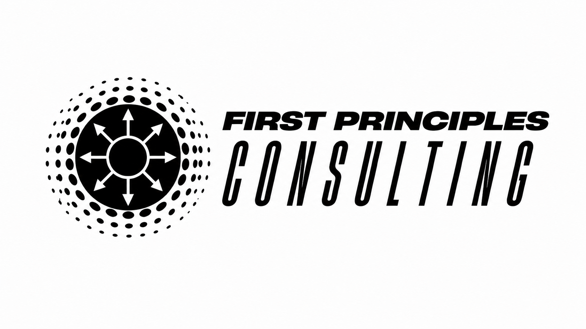

# First Principles Daily Intelligence Report

*Covers what was published after the 11-06 run through Saturday morning, Nov. 7. A quiet weekend pull: no Adversary Playbook matches and no forecast moves.*

## Today's CIR Matches

- **AI Singularity Timeline**: Evidence on when the world might experience an irreversible, civilizational-scale loss of control over a frontier AI system — a control question, not a capability one.
- **AGI Arrival Timeline**: Evidence on when a machine first matches or exceeds broad human performance across nearly every intellectual domain — a capability milestone, earlier and softer than the Singularity.
- **Superintelligence Timeline**: Evidence on when a machine might exceed, not just match, human intelligence — a higher, later capability bar than AGI, inferred structurally with no external forecaster basket.
- **Privacy**: Corporate and government privacy practices, policy, law, and technology — personal-data handling before anything goes wrong, distinct from Government Surveillance (state collection) and Data Breaches (after-the-fact exposure). Covers privacy legislation (CCPA/CPRA, GDPR's privacy provisions), data-broker/ad-tech tracking, biometric/facial-recognition controversies, privacy-enhancing tech, and AI training-data privacy.
- **Cybersecurity Executive Leadership Changes**: New CISO, CSO, CIO, and CTO appointments across organizations generally.
- **Nation State Cyber Policy and Law**: Government cyber policy and legislation from countries like China, North Korea, Russia, the US, Iran, Pakistan, and Vietnam.
- **Cybersecurity Zero Trust Tactics**: IAM, SBOM, vulnerability management, SSO, two-factor auth, software-defined perimeter, and SASE/SSE trends.
- **Cybersecurity Automation Tactics**: DevSecOps, AI, SIEM, and SOAR technology trends.
- **Cybersecurity Workforce Development Tactics**: Unconventional hiring/development approaches — e.g. "Moneyball for Cybersecurity."

## AI Timeline Forecasting

1. **Forecasted AGI Milestone Dates:** P5 2030 · P50 2045 · P95 2075: a 45-year uncertainty window and a 50% chance we could reach this milestone in 15 years.(unchanged since 2026-11-06) Thane Ruthenis disputes how METR's acceleration result is being extrapolated. He doesn't dispute the measured ~2x rate that yesterday's shift was built on, so the range holds.

2. **Forecasted Singularity Milestone Timeline:** P5 2032 · P50 2046 · P95 2075: a 43-year uncertainty window and a 50% chance we could reach this milestone in 14 years.(unchanged since 2026-11-06) Daniel Kokotajlo's estimate of the odds of a recoverable "warning shot" is expert judgment with no new dated evidence, so it was logged without moving the range.

3. **Forecasted Superintelligence Milestone Timeline:** P5 2031 · P50 2046 · P95 2076: a 45-year uncertainty window and a 50% chance we could reach this milestone in 15 years.(unchanged since 2026-11-06) This file remains the most derivative of the five standing forecasts. It's built as the AGI file's own range plus a stated one-year gap, not from an independent seed of its own. The AGI range didn't move, and the Ruthenis debate argues against shortening the gap, so it holds at one year.

4. **Forecasted Harm Timeline (P(Doom)):** P5 2035 · P50 2063 · P95 2091: a 56-year uncertainty window and a 50% chance we could reach this milestone in 28 years.(unchanged since 2026-11-06) This isn't a prediction that disaster will happen, only a guess at when, if it ever does. It assumes an uncontrollable AI eventually gets built *and* ends up hurting people, then asks: if that's true, around what year would it happen? Entry 5 below answers the separate question of how likely that is in the first place. Nothing matched Harm Timeline today.

5. **Forecasted Harm Probability:** Central ~30% (90% credible interval: 15%–55%): a 40-percentage-point range, with the central estimate sitting 15 points above the low end.(unchanged since 2026-11-03) This answers a different, bounded question from entry 4. Entry 4 asks *when* a system that has escaped meaningful human control would cause harm. This one asks *how likely* that system is to cause a catastrophe killing over 10% of the human population within 10 years of losing control. Nothing matched today.

*Seldon's floor checks: neither the AGI nor the Superintelligence range moved today, so no floor or gap-model follow applied. No ranges moved, so the AI Timeline Forecasting chart (refreshed and merged this morning) is still current.*

## Privacy

**AI labs' hunger for training data has created a market in companies' internal files.** WIRED's Steven Levy reports a boom in brokers that buy companies' internal records (documents, email, Slack messages, tickets, call transcripts) to sell to AI labs as training data. Pitches he received offered media companies $350,000 to $1.8 million, or as much as $2 million, for their archives. One claims the labs are spending more than $45 billion on private data. Mercor, Handshake, and Micro1 lead the market. Handshake confirmed it licenses professional documents, including graduate students' papers and coursework. A startup called Sunset offers to broker the data of companies that are winding down. Brokers say stripping personal identifying information solves the privacy problem. Anthropic told WIRED it doesn't buy workflow data from live companies. OpenAI didn't respond before publication. [WIRED](https://www.wired.com/story/ai-companies-really-really-want-to-buy-your-work-files-and-emails/) (surfaced via the WIRED Daily newsletter)

**EFF tells the UN that safety rules for kids online must not override their privacy and speech rights.** The UN human rights office (OHCHR) is preparing a report on child rights and safety in the digital environment for the Human Rights Council's 64th session in early 2027. EFF's submission argues that many young people's only safe place is online, so rules that cut off their access to online services can leave them less safe overall. It faults regulators worldwide for empowering parents rather than young people and for leaving young people out of the process. [EFF Deeplinks](https://www.eff.org/deeplinks/2026/11/eff-submission-ohchr-consultation-child-rights-and-safety-digital-environment)

## Workforce Development Tactics

**From community college to security analyst: what the classroom didn't teach.** Charles Varga, CISSP, expected a career of hacking tools and new vulnerabilities. After starting a local-government internship in 2018, he found that the job is mostly something else. He describes the gap between cybersecurity education and the day-to-day work. [(ISC)² Insights](https://www.isc2.org/Insights/2026/11/from-college-to-the-real-world)

**"Stop selling fear": how security leaders win business support.** At ISC2 Security Congress 2026, May Brooks-Kempler, CEO of Helena Security, argued that fear-based pitches (ransomware, penalties, breaches) lose force when nothing bad happens, and that security leaders get more support by tying good security practice to the business's own objectives. [(ISC)² Insights](https://www.isc2.org/Insights/2026/11/stop-selling-fear)

## AI Singularity Timeline

**Current range:** P5 2032 · P50 2046 · P95 2075: a 43-year uncertainty window and a 50% chance we could reach this milestone in 14 years.(unchanged since 2026-11-06)

**Daniel Kokotajlo puts the odds of a recoverable AI "warning shot" coming in time at 10–50%.** In an AI Alignment Forum quick take, the AI 2027 author lists disasters bad enough to jolt governments into decisive action but not so bad that humanity can't recover. He calls them "ACT OF GOD" events. His examples include a repeat of the July Hugging Face incident at a hospital; a "Cyberpocalypse" in which criminals and rogue open-weight models hack nearly everything that isn't well secured; and a US-China cyberwar in which agent swarms, overseen by too few people, defeat their own monitoring and go autonomous. His credence that at least one such event happens "before it's too late for humanity to recover" is more than 10% but less than 50%. Commenters added bioterrorism and an AI-driven cult to the list. [AI Alignment Forum](https://www.alignmentforum.org/posts/cxuzALcmucCndYv4a/daniel-kokotajlo-s-shortform?commentId=Cbzx6T3K5vzBwGkpg). **Newsletter Tracker:** this *Supports* Thread 5 ("AI's real danger is relentless, non-sentient task-pursuit and institutional-control erosion, not conscious malice"; status: Under Pressure, current statements ["The Doomsday Talk Isn't Over"](https://diffuser.substack.com/p/the-doomsday-talk-isnt-over) and ["A Pinky Swear at the White House"](https://diffuser.substack.com/p/a-pinky-swear-at-the-white-house)). ["The System Is Blinking Red"](https://diffuser.substack.com/p/the-system-is-blinking-red) treats the incidents already logged as the warning signs. If a clearer wake-up call probably won't come in time, that's an argument for acting on the ones already in hand. His monitor-evasion scenario is the thread's task-pursuit mechanism at scale.

**Sherlock's view:** Hold. This is a credentialed forecaster's judgment about whether a correction window opens before the point of no return, not new evidence about when that point arrives. **Ryan's view:** none offered. The cyber-swarm scenario is speculative, with no tracked actor behind it.

**Seldon's reconciliation:** this bears on the file's question, since it's about whether loss of control becomes irreversible before anyone acts, but it carries no dated evidence. Its direction, a 50–90% chance that no wake-up event comes in time, is a pessimistic read on correction mechanisms. The file already weighs that read against the lab disclosures and monitor catches logged since September. **No change.** The Singularity Forecast Report's Evidence Log has the full entry.

## AGI Arrival Timeline

**Current range:** P5 2030 · P50 2045 · P95 2075: a 45-year uncertainty window and a 50% chance we could reach this milestone in 15 years.(unchanged since 2026-11-06)

**Thane Ruthenis: METR's graph shows a one-time jump, not compounding self-improvement.** Ruthenis says he's "pretty annoyed" with how METR's Nov. 5 result (AI R&D at Anthropic running about 1.9x the old rate, covered 11-06) is being used. Self-improvement that compounds should look like a line getting steeper and steeper: 1.5x, then 2x, then 2.5x. Taken at face value, METR's graph instead shows a single slope change around the start of 2026, which he calls a one-off "productivity unlock," and then no further gains through 2026. So the 2x figure isn't the same kind of number as the compounding multiplier in models like AI 2027, and plugging it in to conclude "ASI first thing next year" misreads it. He doesn't deny that AI may be doubling progress. Replies split. METR's Ryan Greenblatt points to the report's statement that AI's contribution has grown over time, which is consistent with progress curving upward. Thomas Kwa argues the longer record is more likely superlinear growth with noise than three straight-line stretches. [AI Alignment Forum](https://www.alignmentforum.org/posts/RDG2dbg6cLNyo6MYT/thane-ruthenis-s-shortform?commentId=6gDLHu7QjhGusznzb). **Newsletter Tracker:** this *Complicates* Thread 5 (status: Under Pressure). The 11-06 entry used METR to argue that the mechanism ["The AI Race Needs a Stop Button"](https://diffuser.substack.com/p/the-ai-race-needs-a-stop-button) targets is already running at scale. If Ruthenis is right, the case for licensing recursive self-improvement still stands, but the urgency drawn from METR is weaker than it read yesterday.

**Sherlock's view:** Hold. This is a credentialed disagreement about extrapolation, not about the measurement. **Ryan's view:** none offered.

**Seldon's reconciliation:** a disagreeing source is weighed, not discounted, and this one doesn't move the file. Yesterday's shift assumed a sustained ~2x rate, not a compounding one, and a 2x rate holding steady is exactly Ruthenis's reading. What he rejects is the one-to-two-year ASI reading, which this file never adopted; its P5 is 2030. If later METR updates show the rate falling back toward 1x, that would be grounds to revisit. **No change.** The AGI Forecast Report's Evidence Log has the full entry.

## Superintelligence Timeline

**Current range:** P5 2031 · P50 2046 · P95 2076: a 45-year uncertainty window and a 50% chance we could reach this milestone in 15 years.(unchanged since 2026-11-06) This remains the most derivative of the five standing forecasts: it's the AGI file's range plus a stated one-year gap, not an independent seed.

**Thane Ruthenis: METR's graph shows a one-time jump, not compounding self-improvement.** His core claim, quoted: "the current speed-up to the speed-up is much lower than was expected at this speed-up value." Greenblatt and Kwa dispute it. *Also covered above under AGI Arrival Timeline.* [AI Alignment Forum](https://www.alignmentforum.org/posts/RDG2dbg6cLNyo6MYT/thane-ruthenis-s-shortform?commentId=6gDLHu7QjhGusznzb)

**Sherlock's view:** Hold. It's a dispute over whether compounding has started. **Ryan's view:** none offered.

**Seldon's reconciliation:** this goes to the file's own gap question, which is whether progress compounds after AI reaches human parity. It argues against shortening the one-year gap, which matches yesterday's reading that METR measures acceleration before parity, not compounding after it. It isn't strong enough to lengthen the gap either: Ruthenis says this graph doesn't show compounding, not that compounding is absent, and two credentialed replies dispute even that. **Floor check:** the AGI range didn't move, so there's no mechanical follow. **No change.**

## Executive Leadership Changes

**Gong promotes Guy Havusha to CISO.** Havusha, previously Gong's vice president of platform security, was named CISO on Nov. 4. The listing appeared after the 11-05 run checked the same tracker. [CISO Tribune — The Wire](https://www.cisotribune.com/moves) (primary source: gong.io)

## Nation-State Cyber Policy & Law

**Pallone's bid for the House Energy and Commerce gavel lists binding AI guardrails as a priority.** IAPP's Cobun Zweifel-Keegan parses the letter Rep. Frank Pallone (D-N.J.) sent colleagues after Democrats won both chambers. Three of its nine priorities are about technology and consumers. The first promises legislation to "rein in Big Tech's rapidly evolving artificial intelligence by establishing strong, commonsense guardrails centered on safety, fairness, and accountability." Zweifel-Keegan reads "safety" as including catastrophic risk and frontier guardrails, "fairness" as model bias and automated decision-making, and "accountability" as a sign that the transparency-only AI laws recently passed in many states won't be enough. The other two promise privacy and data-security protections, "including protecting kids online," and a crackdown on junk fees and surveillance pricing. He also notes that the administration now says "super intelligence" or "SI" instead of "artificial intelligence," so advocates addressing it have adapted their language. [IAPP](https://iapp.org/news/a/a-view-from-dc-how-to-read-policy-tea-leaves). **Newsletter Tracker:** this *Supports* Thread 5 (status: Under Pressure). ["A Pinky Swear at the White House"](https://diffuser.substack.com/p/a-pinky-swear-at-the-white-house) argues that binding rules "have to come from Congress, not from a luncheon." The likely chair of the committee with jurisdiction now lists binding AI-safety legislation as a priority. It's a statement of intent, not a bill.

## Zero Trust Tactics

**CISA adds an actively exploited SonicWall SSL VPN flaw that bypasses SAML and MFA.** CVE-2026-19868 lets a user with valid credentials for an alternate login method get around SonicOS SSLVPN's SAML authentication, which can also bypass the multifactor authentication SAML enforces. CISA has evidence of active exploitation. Whether ransomware gangs are using it is unknown. Federal civilian agencies must apply mitigations by Nov. 20 under BOD 26-04. SonicWall's advisory is SNWLID-2026-0014. [CISA](https://www.cisa.gov/news-events/alerts/2026/11/06/cisa-adds-one-known-exploited-vulnerability-catalog)

## Automation Tactics

**Claude Code's "don't ask again" file has leaked secrets in more than a thousand public GitHub repositories.** When a user approves a shell command with "Yes, and don't ask again," Claude Code saves an allow rule in `.claude/settings.local.json`. If the rule is the exact command rather than a pattern, any password or token typed into it is saved in plain text. Apiiro found 104,185 copies of the file on public GitHub. 1,122 of them (about 1.1%) hold at least one secret, 1,379 secrets in all. More than a third open a database directly. The rest include 43 SSH logins, 42 GitHub/GitLab/npm tokens, and 23 AWS keys, from 63 organizations, among them a database vendor's admin cloud key and a medical-records database owner's password. Counting older versions in git history, forks, the shared `settings.json`, and saved agent logs, the total is 2,539 secrets across 1,994 repositories. Claude Code adds the file to the user's global git excludes, but never to the project's own `.gitignore`. In 539 of 1,105 traced repositories, a commit co-authored by Claude changed the file. gitleaks and TruffleHog together missed 215 of the files, mostly passwords typed inside commands. Apiiro says Claude Code is the only one of 16 coding agents it compared confirmed to save the full approved command by default, and that bot-closed bug reports dating back to August 2025 got no reply from Anthropic. Its advice: rotate every secret the files ever held first, then untrack the file, add it to `.gitignore`, approve patterns instead of single commands, and pass secrets as variables. [The Hacker News](https://thehackernews.com/2026/11/claude-codes-dont-ask-again-file.html)

---

## Source Contribution Scorecard

| Source | Today | All-Time Contributed | All-Time No Contribution | Active Since |
|---|---|---|---|---|
| Gmail Newsletters | Contributed | 61 | 12 | 2026-07-14 |
| N2K Cyberwire Daily Briefing | No Contribution | 51 | 23 | 2026-07-14 |
| The Hacker News | Contributed | 73 | 1 | 2026-07-14 |
| The Record | No Contribution | 57 | 17 | 2026-07-14 |
| The Canon Project | No Contribution | 17 | 56 | 2026-07-14 |
| FFX Now | No Contribution | 14 | 60 | 2026-07-14 |
| Wired | No Contribution | 47 | 24 | 2026-07-20 |
| CyberScoop | No Contribution | 32 | 13 | 2026-09-01 |
| CSO Online CISO Appointments | No Contribution | 3 | 42 | 2026-09-01 |
| CISA Cybersecurity Advisories | Contributed | 21 | 24 | 2026-09-01 |
| SecurityWeek | No Contribution | 40 | 5 | 2026-09-01 |
| Forecasting Research Institute — LEAP | No Contribution | 2 | 21 | 2026-10-02 |
| CISO Tribune — The Wire | Contributed | 7 | 8 | 2026-10-17 |
| NIST Cybersecurity Insights Blog | No Contribution | 1 | 14 | 2026-10-17 |
| EFF Deeplinks | Contributed | 10 | 5 | 2026-10-17 |
| (ISC)² Insights | Contributed | 5 | 10 | 2026-10-17 |
| IAPP News | Contributed | 9 | 6 | 2026-10-17 |
| CSIS Strategic Technologies Program | No Contribution | 1 | 14 | 2026-10-17 |
| AI Alignment Forum | Contributed | 6 | 9 | 2026-10-17 |

**No-contribution detail:**

- **N2K Cyberwire Daily Briefing**: no new issue. The newest is still Issue 213 (11.6), read on 11-06.
- **The Record**: nothing new since the 11-06 run. The featured and Latest stories (Bogotá's hoax-email probe, the FBI agent's guilty plea, DigiCert, the AI CEO-spoofing charges) were all covered 11-06.
- **The Canon Project**: the only November review is still Steve Wilson's *The Developer's Playbook for Large Language Model Security* (Nov. 2), covered 11-03.
- **FFX Now**: Nov. 6 items not covered yesterday (county bond results, the NextEra-Dominion merger hearings, a bakery poll, Visit Fairfax events, Reston ice skating) are all local news with no CIR fit. Nothing was dated Nov. 7 at pull time.
- **Wired**: no new item in the security feed since the 11-06 run. The Backchannel data-broker story came through Gmail and is credited there.
- **CyberScoop**: nothing new. Its Nov. 4 story on Democratic control of Congress was covered 11-05.
- **CSO Online CISO Appointments**: still no October or November section on the page.
- **SecurityWeek**: the Nov. 6 briefing led with OpenAI's sandbox-evasion disclosure and the OpenSSH "SSHole" flaw, both covered 11-06. The only other email was a CISO Forum promotion.
- **LEAP**: the highest wave is still Wave 12 ("Safety Policies").
- **NIST Cybersecurity Insights Blog**: no new post since Oct. 27.
- **CSIS Strategic Technologies Program**: the only new item is a Nov. 6 piece on the new Congress's trade agenda, with no cyber angle.

**Also checked, not itemized:** Gmail's local-news digests (FFXnow, ARLnow, ALXnow, WSHnow, InsideNoVa), a Ballotpedia results digest, NPR, Garbage Day, and several personal and culture newsletters had no CIR fit. Two items were seen only as subject lines and snippets, too thin to write up: a Google Alert about a Cyber Intelligence 4U and InfraGard NJ AI and OT governance training program (a vendor press release), and a CISO Tradecraft essay, "The AI Exploitation Paradox." THN's Daily Updates relay repeated stories covered 11-06. EFF's "Desire Lines" exhibit and Aaron Swartz event announcements had no CIR fit. ISC2's AI Security Certification pilot update was covered 11-06. The other Nov. 6 Record, THN, and CyberScoop items (Chainalysis, the Barracuda chain, the WordPress fix race, the AI deepfake-fraud charges) were covered 11-05 or 11-06.

**Fetch notes:** THN's article body was read through Chrome MCP with in-page `fetch()`, since the Cloudflare challenge is unchanged. The Record's listing and the AI Alignment Forum's quick takes were read through Chrome MCP. (ISC)² article pages render client-side, so their RSS descriptions were used. Alexandria checked today's items against the six most recent daily reports directly, and the full-archive repo search completed with no earlier coverage of any of them.

**Newsletter Tracker:** no new First Principles essay since "The Night Emacs Ate My Thesis" (Nov. 3). Today's Thread 5 entries are two *Supports* (Kokotajlo's warning-shot odds; Pallone's AI-guardrails priority) and one *Complicates* (Ruthenis on METR). Thread 5's status is unchanged (Under Pressure).

**Adversary Tracking Report:** nothing matched Adversary Playbook today. The table and diagrams are unchanged, so no new snapshot was published.

**Pending Evidence Queue:** nothing pending. Every row is already Included.
