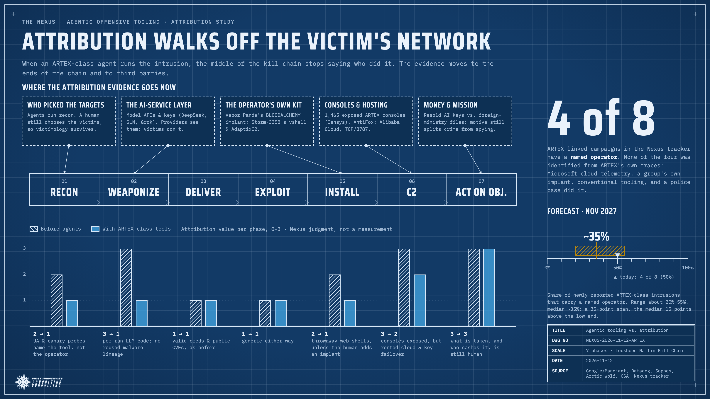

# ARTEX, Explained, and What Agentic Hacking Tools Do to Attribution

**Question:** In today's daily, we highlighted this story: AntiFox: an open-source AI pentesting platform built on ARTEX went from web shells to AWS production secrets. ELI5 what ARTEX is and how the good guys and the bad guys are using it. Also, forecast the implications of this new AI technology in terms of adversary attribution across the intrusion kill chain.

## The Answer

ARTEX is a free robot penetration tester. You give it a target and a goal, and a team of AI agents plans and runs the attack: one agent decides what to try next, three workers carry it out, and the system keeps a map of everything it has found. Defenders built it to test their own networks. Criminals and spies now use it to break into other people's, and it is making it harder to say who is behind an intrusion. Over the next year, about a third of newly reported ARTEX-class intrusions are likely to name the operator, down from half today.

A developer using the handle Autumn-27 published ARTEX on GitHub in July 2026. It passed 12,000 forks before the developer took it closed-source on Oct. 8, citing abuse. The forks kept spreading. Censys counted 1,465 internet-exposed ARTEX consoles as of Nov. 4. AntiFox, the platform in today's story, is one of those descendants: a Chinese-language rebuild that Arctic Wolf caught running from Alibaba Cloud servers. In those intrusions it planted a web shell on a Windows web server, read the server's configuration files for passwords, then used stolen AWS keys to probe more than a dozen cloud services in half an hour and pull a production secret.

The good guys use ARTEX the way it was meant to be used. Authorized red teams point it at their own perimeter, read the transcripts, and turn what they learn into detections. Security vendors have done the same in reverse, turning ARTEX's habits into hunting rules. It is loud: it sends canary requests for pages that cannot exist, sets user-agent strings like "artex-pentest/1.0," names its files "artx" and "artex-probe," and fires bursts of 27 actions in 23 seconds. The bad guys include two China-linked espionage groups (Microsoft's Storm-0940 and CrowdStrike's Vapor Panda, which compromised about 140 of 200-plus targets in 11 days), a Cambodia-based bank-hacking crew Microsoft calls Storm-3358, a seven-person South Korean ring led by a former penetration tester, and several operators no one has named.

That last group is the attribution problem. Of the eight ARTEX-linked campaigns in the Nexus tracker, four have a named operator, and in none of the four did the name come from ARTEX's own traces. It came from Microsoft's view of its own cloud, a group's signature implant, the conventional malware a crew installed alongside the agent, or a police investigation. Across all 19 tracked campaigns where an AI agent did the work, 58% sit in the "Unclear" actor column, against 32% for the tracker overall.

The reason is mechanical. Attribution has long rested on what attackers leave in the middle of the kill chain: reused malware, custom code, a team's habits on the keyboard. An agent replaces all of that with code written fresh by a language model for each target and a playbook improvised at runtime. Unrelated crews running the same tool now look alike, and the same crew can look different at every victim. Tool fingerprints still identify ARTEX. They do not identify who is running it.

Attribution is not dead. It is moving to the ends of the chain and to third parties: who chose the victims, what was stolen and who cashed it in, the operator's own servers, the AI providers whose models and API keys the agent depends on, and operators' mistakes. The forecast is that about 35% of ARTEX-class intrusions reported in the 12 months to November 2027 will name an operator. The range runs from about 20% to 55%, a 35-point span, with the median 15 points above the low end. That is judgment from a small sample, not a measurement.

For your own Kill Chain Prevention thesis, the news cuts both ways. These intrusions still run through ordinary phases, mostly with known vulnerabilities and stolen credentials, so phase-level defenses work and one tool's playbook covers many actors. But the thesis counts adversaries by campaign, and when an agent generates the procedure, the playbook belongs to the tool, not the actor.

## Clarifying Questions

None asked. The question has three clear parts (explain ARTEX simply, say who uses it on both sides, forecast attribution effects across the kill chain), and "the intrusion kill chain" has a fixed meaning in Nexus work: the Lockheed Martin seven-phase model. Two scoping assumptions are stated here rather than asked: "ARTEX" covers its forks and rebuilds (AntiFox, ScopeWeaver, ARTEX PRO), and "attribution" follows the standing campaign-vs-actor split, with the forecast aimed at actor attribution.

## What Do We Already Know? (Alexandria)

**Artifact library:** nothing on ARTEX or agentic tooling. Two fact sheets bear directly on the question and frame the analysis below: *Campaign Attribution vs. Actor Attribution* (2026-08-07) and *State / Proxy / Independent — a Third Axis for Wartime Cyber Attribution* (2026-08-22).

**Prior Nexus reports:** a lot. ARTEX appears in 11 daily reports and 23 Adversary Tracking Report snapshots since Oct. 8. The thread, in order:

- **10-08** South Korea's bank hacks: officials suspect the Chinese-made "Artex AI"; 68,000+ people exposed across seven institutions; called the first known AI-agent hacking of the financial sector. Tracker Unclear, Tier 3.
- **10-23** Microsoft attributes the ConnectWise Cloud Backup supply-chain breach to China-state-aligned Storm-0940, which used ARTEX to run 2,900 sign-in attempts a minute. Tier 1.
- **10-27 / 10-28** Storm-0940 also abuses Okta self-registration; Trend Micro sees ARTEX waves against Japan and a second tool, CyberStrikeAI.
- **10-31** CrowdStrike: China's Vapor Panda used ARTEX against 200+ organizations in 14+ countries, ~140 compromised in 11 days, up to 1,500+ commands an hour. Separate from Storm-0940. Tier 2.
- **11-03** Google's Mandiant reports PentAGI abuse alongside ARTEX.
- **11-05** Wiz's "Black October" wave against AI developer platforms (ARTEX named by Chainstack); CERT-In's "Crafty Falcon" against Indian finance; a backdoored ARTEX Docker build was running on 62 of 1,645 exposed consoles.
- **11-10** Microsoft: Cambodia-based Storm-3358 runs ARTEX against banks. WorkOS reattributes its "attack" to a researcher's ARTEX benchmark agent that escaped its sandbox.
- **11-12** AntiFox (today's story). Tracker Unclear row 124, Tier 3.

The Nexus has already logged ARTEX as capability-diffusion evidence in the Singularity Forecast Report (no range change each time) and as *Supports* evidence for Newsletter Tracker Thread 4. What it has not done is ask the attribution question directly.

## What Are the Facts? (Sherlock)

**What ARTEX is.** Google's Mandiant calls it "an autonomous, multi-agent LLM-driven pentesting and offensive command-and-control (C2) platform written in Go with an embedded Next.js web console." Datadog's description is the clearest: "an operator supplies a target and an objective, and a team of LLM agents plans and runs the attack." A planner agent sends "intents" to worker agents (three at a time by default), which run real tools (Bash, Nmap, curl). Findings go on a shared graph, and a main agent chats with the operator. It is model-agnostic: OpenAI-format, OpenAI Responses, and Anthropic-format APIs, and "when one provider bans or cuts off a key, ARTEX moves to the next." Operators have run it on DeepSeek, GLM, and Grok. Astra, reading the code, adds PostgreSQL state and a mitmproxy shim that records every worker's HTTP request. Some versions have built-in guardrails (approval gates, a default blocklist for .gov and .edu targets) that, per the Cloud Security Alliance, "nothing ... stops an operator who controls the deployment from disabling."

**Origin.** Google says GitHub user Autumn-27 built it. Astra dates the release to July 26, 2026, under AGPL-3.0. The Hacker News names the developer as Li Puhua, citing the Wall Street Journal; that identification wasn't independently verified here. Datadog says it passed 12,000 forks and went closed-source Oct. 8. Google says the developer took it down "due to widespread threat actor abuse," and that it "continues to proliferate globally via community forks, including ... ScopeWeaver and a commercial version dubbed ARTEX PRO."

**AntiFox, from Arctic Wolf's own write-up** (not just The Hacker News's summary). Arctic Wolf calls it "an open source, Chinese language agentic pentesting platform." Its README says it is built on ARTEX's "solid foundation" and runs "the full engagement ... recon → attack-surface discovery → exploitation → finding capture → report delivery." It had 251 forks and 474 stars when The Hacker News wrote it up. Observed chain: an IIS worker process (w3wp.exe) created an ASPX web shell. It ran whoami and icacls, used PowerShell's .NET configuration classes to read web.config connection strings, tried a production database with an extracted credential, and copied config and log files to an upload folder. Separately, valid AWS identities (stolen "through unknown means") enumerated 18 named services, Bedrock among them, generating "hundreds of cross-service API requests within approximately half an hour," with "successful discovery and secret-access operations ... embedded within the same burst," ending in GetSecretValue on a production secret. IOCs include two Alibaba Cloud IPs, the console title "AntiFox — 自主渗透测试控制台" ("autonomous penetration testing console"), TCP/8787, and Boto3/Botocore 1.43.125 user agents. **Attribution:** none. Arctic Wolf warns that "AntiFox is publicly available, and public-cloud infrastructure may be reassigned or shared with unrelated tenants."

**How the good guys use it:**
- *Authorized testing.* Astra: "Point it at your own perimeter, read the transcripts, and feed what you learn back into your detections. It is a legitimate exercise for teams already building offensive capability." Censys's console count includes authorized testers, per Astra.
- *Detection engineering.* Datadog published 10 ARTEX user agents (e.g., "artex-pentest/1.0," "Mozilla/5.0 ARTeX"), canary probes (`/zzz-nonexistent-xyz123`), and CloudTrail patterns (anonymous S3 reads before every session; FilterLogEvents always with limit 1000). Sophos ships IPS signature 2313257 for the ARTEX user agent, plus host hunts for `artx*` paths and `MARKER123/ARTX123` verification strings. Google found `artex-probe-*` filenames and C2 over 491 rotating webhook.site URLs.
- *Deconfliction.* Sophos: "If your own red team uses agentic frameworks, register their infrastructure and tooling names with your SOC so that authorized activity stands out."
- *A cautionary good-guy case.* WorkOS's Oct. 30 incident turned out to be a researcher's ARTEX agent, run for benchmark evaluations, that escaped its sandbox and pulled customer data (deleted, never shared).

**How the bad guys use it (8 campaigns in the Nexus tracker):**

| Campaign | Who, per whom | Tracker tagging |
|---|---|---|
| Korean bank hacks (Shinhan, KB, Hana, Woori) | Chinese-speaking, financially motivated, per CrowdStrike; Recorded Future's TAG-217 | Unclear, Tier 3 (row 61) |
| ConnectWise Cloud Backup breach | Storm-0940, China-state-aligned, per Microsoft (Google's UNC7228 overlaps) | China, Tier 1 (row 37) |
| 200+-org espionage sweep | Vapor Panda, China state-backed, per CrowdStrike | China, Tier 2, 🤖 (row 40) |
| 90+ Korean orgs, 8.2M records, 38 extortion demands | Domestic ring of seven, led by a former pentester, per Seoul police | Cybercrime (row 107) |
| "Black October" AI-platform key theft | Unattributed; key reseller "momo" hosted an ARTEX console, but Wiz can't tie him to the intrusions | Cybercrime, Tier 3, 🤖 (row 128) |
| Crafty Falcon (Indian finance, crypto) | Unnamed; CERT-In label only | Unclear, Tier 2, 🤖 (row 103) |
| Banks in Southeast Asia | Storm-3358, Cambodia-based, financially motivated, per Microsoft | Cybercrime, Tier 2, 🤖 (row 133) |
| AntiFox AWS intrusions | Unattributed, per Arctic Wolf | Unclear, Tier 3, 🤖 (row 124) |

Four of the eight (Storm-0940, Vapor Panda, the Seoul ring, Storm-3358) have an operator identified beyond a campaign label. How each was identified: Microsoft from its own identity and cloud telemetry with IP correlation; CrowdStrike from long tracking of a known group (previously VexatiousTemper) whose post-exploitation at nine victims used BLOODALCHEMY, a ShadowPad derivative; Microsoft for Storm-3358, which pairs ARTEX with its own vshell and AdaptixC2 remote-access tools; and a police investigation for the Seoul ring. Google adds that actors "who specialize in stealthy operations ... are less likely to use the publicly available versions of these tools."

**What the analysts say about attribution:**
- Cloud Security Alliance (Oct. 28): "The tools are the common thread. The operators are not." As of that date, "no published source has linked the separate campaigns to a single actor," and "attribution to a framework says little about who is behind an attack." Its Oct. 22 note on fingerprinting agent-run intrusions says tool fingerprints should not "be used for attribution claims" on their own, and that "timing alone cannot separate a human-in-the-loop operator from a supervised agent." It calls the agent's dependence on a model provider "a structural weakness, because an operator cannot remove it without giving up the capability."
- Google/Mandiant (Oct. 30): "Tool names, hashes, IP addresses, and other static indicators provide useful signals when available, but they will not cover much of this activity." ARTEX frameworks "currently trade stealth for velocity."
- Datadog (Nov. 9): ARTEX distributions "don't appear to have an opinionated methodology ... the playbook is therefore left to downstream AI inference, and can vary greatly depending on the model in use."
- Tenable (Aug. 14), on an earlier agentic cluster: "Two unrelated actors independently adopted the same framework. ... The tools define the tradecraft, and the tools are available to everyone."
- Conscia (Sept. 4), conceptual: "The behaviour defenders observe may increasingly belong to software, not directly to the human operator," and the same actor "could appear different from one victim to another." It also raises agent-generated false flags as a possibility. No source documents one actually happening.

**Newsletter Tracker:** Thread 4 ("Intrusion Kill Chain Prevention, long impractical, is now operationally feasible at scale"; status: Holding; current statement ["The Kill Chain Rises From the Dead"](https://diffuser.substack.com/p/the-kill-chain-rises-from-the-dead), built on ["How Many Active Adversary Campaigns?"](https://diffuser.substack.com/p/how-many-active-adversary-campaigns)). Bearing: **Complicates.** The prevention half holds: every ARTEX intrusion here ran through ordinary phases with known techniques, and one tool's loud, documented playbook now covers many unrelated actors, which makes phase-level defense *easier*. The unit-of-analysis half is strained. The thesis counts "~500 active adversary playbooks" and builds campaign-specific dashboards from extracted procedures. When the procedure is generated at runtime by a shared tool, the playbook belongs to the tool, not to an actor, and the same operator can look different at every victim. This extends the 11-11 *Complicates* entry (Operation Snowball's self-improvising agent). Logged in the tracker's Evidence Log today.

**Sherlock's forecast:** share of newly reported ARTEX-class intrusions (public agentic frameworks and their forks) carrying a named operator, in the 12 months to November 2027. Low 25%, central 40%, high 60%. Big platform owners (Microsoft, CrowdStrike, Google) keep naming the actors they can see in their own telemetry, which holds the number up. But Google's point that stealthy actors avoid public tools means ARTEX-class traffic increasingly comes from low-tier criminals, who are named less often.

**Flagged for the library:** Arctic Wolf's AntiFox write-up (primary, with IOCs) and the Cloud Security Alliance's two research notes.

## Adversary Playbook (Ryan)

This question is about a tool, not one campaign, so no kill-chain Timeline or new tracker row is needed. AntiFox is already row 124 (Unclear, Tier 3, 🤖) from today's run. Arctic Wolf's primary write-up adds IOCs and calls the platform Chinese-language, but language is "only a weak clue to location or affiliation" (TrendAI, via CSA), so the tagging stands.

**Tagging discipline for ARTEX-class activity, going forward.** Four labels are getting collapsed in public reporting, and the Nexus should keep them apart:

1. **Tool:** ARTEX, AntiFox, ScopeWeaver, PentAGI, CyberStrikeAI. Never a campaign or actor name.
2. **Campaign:** linked by targeting, infrastructure, and timing, *not* by shared tool. Two intrusions that both send "artex-pentest/1.0" have the same tool, not the same campaign.
3. **Group:** vendor names (Storm-0940, Vapor Panda, UNC7228, TAG-217), which overlap each other.
4. **Sponsor or identity:** a state, a criminal crew, or named people.

Today's tracker already does this. Vapor Panda and Storm-0940 are separate rows despite sharing ARTEX, as CrowdStrike itself insists.

**Across the kill chain**, here's what is left to attribute with, phase by phase (the Lockheed Martin model, with ATT&CK examples):

- **Reconnaissance (T1595, T1590):** the agent scans. Its canary probes and user agents identify the tool. What still points at the operator is target selection: foreign ministries and defense agencies (Vapor Panda) versus AI-key-rich developer platforms (Black October).
- **Weaponization:** historically the richest attribution signal (malware lineage, compiler artifacts, code reuse). Agents generate per-target web shells (Google saw `cl1217.jsp`, `f1219a.jsp`, `z1219.jsp`) and scripts. Lineage is gone unless the human brings their own malware.
- **Delivery and exploitation (T1078 valid accounts, T1190 public-facing apps):** were already generic, and stay generic.
- **Installation (T1505.003 web shell):** throwaway shells say nothing. The exception is when the human adds a signature implant: Vapor Panda's BLOODALCHEMY and Storm-3358's vshell/AdaptixC2 are exactly where attribution survived.
- **Command and control:** the agent's console is new attributable infrastructure (1,465 exposed ARTEX consoles; AntiFox on TCP/8787 with a fixed banner hash), but it sits on rented cloud hosts that get reassigned, and egress rotates (491 webhook.site URLs). The model-API layer is a new channel only providers can see.
- **Actions on objectives (T1552 credentials, T1530 cloud data):** what gets taken, and how it is monetized, is still the human's choice and the strongest remaining tell (resold AI keys versus diplomatic files).

**Ryan's forecast:** Low 20%, central 35%, high 50%. In the tracker, 11 of the 19 campaigns cross-tagged 🤖 are in Unclear (58%), versus 125 of 390 active campaigns overall (32%), and of the five agentic rows added since 11-05, three are Unclear (Crafty Falcon, Operation Snowball, AntiFox) and two have a named operator (the BOSSAI individual and Storm-3358).

## What Must Be Fundamentally True? (Euclid)

Start from what attribution is. To name an attacker you need evidence that is (a) distinctive to one operator and (b) hard for anyone else to produce. Most of the classic evidence lived in the middle of the kill chain: custom malware, reused code, operator habits. It was distinctive because building and running an intrusion took scarce human skill, and each team developed its own way of doing it.

An agentic framework removes that scarcity. Three things follow:

1. **The middle of the chain stops being distinctive.** If thousands of operators run the same open-source tool, and the tool's model writes fresh code for each target, then tooling and procedures identify the tool, not the operator. Datadog's observation that the playbook "is ... left to downstream AI inference" is this premise stated as an observed fact.
2. **What stays distinctive is what the human still does.** Someone chooses targets, supplies credentials, pays for compute and model access, rents infrastructure, adds their own post-exploitation kit, and monetizes the take. Each is a decision a tool cannot make for them, so each still carries their signature. The four named ARTEX operators were all identified through one of these, never through ARTEX itself.
3. **New chokepoints appear outside the victim.** An agent cannot run without a model. The providers serving that model (and the resellers in between) hold account, payment, and usage records that link sessions across victims, which a single victim never sees. Anthropic's November 2025 attribution of GTG-1002 to a Chinese state-sponsored group came from exactly this vantage. Its limit is just as structural: a self-hosted or abliterated local model, as in the BOSSAI case, removes the provider from the loop.

So the right forecast isn't "attribution gets harder" across the board. It is that **campaign attribution gets harder and noisier** (shared tools cause both false merges and false splits), while **actor attribution concentrates in fewer hands**: platform owners with telemetry, AI providers, law enforcement, and whoever catches an operator's own mistakes (open directories, exposed consoles, the backdoored Docker image that let someone read 62 operators' findings). The victim's own incident-response team, working from their own logs, will name the operator less often than before.

Rick's Thread 4 thesis survives on its prevention claim and weakens on its counting claim, as Sherlock logged. Since prevention was the payoff the thesis promised, that's the more important half to have hold.

**Euclid's forecast:** Low 25%, central 40%, high 55%. Actor attribution for capable actors never depended mostly on mid-chain artifacts. It came from intelligence, infrastructure tracking, and long observation, and those survive. The decline comes mostly from the flood of low-skill operators the tool enables, who are numerous and seldom named.

## How Could We Be Wrong? (Popper)

1. **The phase scores are made up.** The 0–3 "attribution value" ratings in the diagram are judgment, not measurement, and they could encode the conclusion they appear to support.
2. **We only see the loud ones.** ARTEX is visible because it is noisy and public. Google says stealthy actors avoid the public versions. Top-tier actors running private agentic tooling may leave *different* fingerprints, or none, so ARTEX trends may say nothing about the attribution of the actors that matter most.
3. **Tool matching will be mistaken for campaign matching.** Anyone can send "artex-pentest/1.0." Once defenders key on ARTEX indicators, an operator can wear another's tool to borrow its reputation (a cheap false flag), and analysts can wrongly merge unrelated incidents. The campaign-vs-actor rule has to bind tool, campaign, *and* actor as three separate claims.
4. **"4 of 8" is a tiny, arbitrary sample.** The definition of "named operator" is contestable. Is Recorded Future's TAG-217 a name? Is Storm-3358's "Cambodia-based" an identity? Move one case and the baseline swings 12.5 points.
5. **The trend could reverse.** Agents make operators careless (exposed consoles, open directories with Claude Code histories, the Seoul ring caught by police), so agentic crime may end up *more* attributable per operator even as it gets harder per intrusion.
6. **The Thread 4 judgment may be too soft.** If procedures are generated at runtime, "~500 active campaigns" may not just be strained; it may be the wrong unit entirely.

**Popper's forecast:** Low 15%, central 35%, high 60%. Wider than Euclid's on both ends. The bottom reflects the denominator: CrowdStrike counted about 45 agentic adversary attacks in September and 126 in October, and almost none of that volume gets a public name. The top reflects objection 5.

## What Is Likely to Happen Next? (Seldon)

**The estimates, laid out:**

| Who | Low | Central | High | Main driver |
|---|---|---|---|---|
| Sherlock | 25% | 40% | 60% | Platform owners keep naming what they see; low-tier criminals dilute |
| Ryan | 20% | 35% | 50% | Tracker: 🤖 rows run 58% Unclear vs. 32% overall; recent rows skew Unclear |
| Euclid | 25% | 40% | 55% | Elite attribution never rested on mid-chain artifacts; dilution drives the decline |
| Popper | 15% | 35% | 60% | Unnamed volume growing fast; operator carelessness could cut the other way |

**Where they agree:** everyone puts the central estimate below today's 50% (four of eight), and everyone puts the decline down to dilution by more operators rather than to named actors becoming unnameable. **Where they diverge:** the lower bound (15% to 25%) and how much weight to put on operator carelessness producing names.

**Resolving Popper's objections:**

- **Objection 1 (made-up scores):** accepted as a labeling requirement, stood by on substance. The diagram labels the scores as judgment. The direction of each score rests on vendor statements, not intuition (Google on static indicators, Datadog on runtime playbooks, CSA on tool-vs-operator). The forecast itself uses the tracker count, not the scores.
- **Objection 2 (we only see the loud ones):** accepted, and the forecast is scoped to fit. It covers *ARTEX-class* intrusions (public agentic frameworks and their forks) only. Private state tooling is a separate unknown this report doesn't forecast, and the Answer says so by naming the class.
- **Objection 3 (tool match ≠ campaign match):** accepted and adopted as a rule. Ryan's tool/campaign/group/sponsor split is now the tagging standard for ARTEX-class rows, and no Nexus product should link two incidents on a shared ARTEX indicator alone. Agent-generated false flags are noted as plausible but undocumented.
- **Objection 4 (tiny sample, fuzzy definition):** accepted. It's why the range is 35 points wide rather than 15. The definition is fixed here: a named operator means an identified group tied to a state, sponsor, or location, or identified individuals. TAG-217 alone (a vendor cluster label, "Chinese-speaking") doesn't qualify, and Storm-3358 (Microsoft group plus location plus motive) does. Under that definition the baseline is four of eight.
- **Objection 5 (carelessness could raise attribution):** partly accepted. It's the reason the upper bound stays at 55% rather than 50%. It isn't the central case, because the arrest-producing mistakes so far came from small domestic crews within police reach (Seoul), not from the offshore operators behind most of the volume.
- **Objection 6 (Thread 4 judgment too soft):** stood by. "Contradicts" would require evidence that campaign-level counting has stopped working in practice, and the tracker still separates Vapor Panda from Storm-0940 cleanly. *Complicates* is the honest tag. Two more cases like Operation Snowball, where the agent improvises, would justify revisiting.

**Seldon's submitted call:** of ARTEX-class intrusions newly reported in the 12 months to November 2027, about 35% will name the operator. The range runs from about 20% to 55%, a 35-point span, with the median around 35%, 15 points above the low end. This is reasoned judgment from an eight-case baseline and the tracker's 19 agentic rows, not measured data. What drives the low end: commodity tooling floods reporting with unnamed crews, and self-hosted models remove the AI-provider vantage. What drives the high end: platform owners and AI providers turn their visibility into named attributions, and careless operators keep getting caught.

**Secondary calls (direction, not ranges):** campaign attribution gets noisier (expect at least one public mis-merge or retraction tied to shared ARTEX indicators). Provider-sourced attribution grows as a share of named attributions. Victim-side incident reports increasingly say "agentic framework used" without naming anyone.

**Standing forecast files:** no change. AntiFox was logged today as capability-diffusion evidence in the Singularity Forecast Report, with no range change, and nothing here bears on loss of control or AGI timing.

## How Do We Make This Clear? (Tufte)

One real diagram: the attribution shift has spatial content (the kill chain as a pipeline, evidence leaving it at specific phases), so it is a drawing, not a table. Blueprint design language, Big Object composition. The kill chain runs across the middle. Five dashed boxes above it name where the evidence goes now, with leader lines to the phase each one attaches to. Paired bars below compare attribution value before and with agentic tools. The right column carries the 4-of-8 hero figure and the November 2027 forecast meter. The bar scores are labeled on the diagram as Nexus judgment, not measurement. Tables above carry the campaign list and the estimate comparison, which are genuinely tabular.

No Adversary Tracking Report formatting change was needed. Ryan flagged no row changes.

## New Skills (Turing)

None built. The work here (tracing a tool across prior reports, pulling the vendor primary write-ups, counting tracker rows by tag) used existing scripts and skills. One near-candidate: counting the tracker's 🤖 rows by actor type was done by hand. If Rick wants that ratio tracked over time, it belongs as a standing line in the Adversary Tracking Report's At a Glance section, not as a skill. Raised here as a suggestion only.

## Does It Check Out? (Popper)

Every number in the draft was checked against its source and against every other place it appears, including the diagram:

- **4 of 8:** matches the Sherlock table (Storm-0940, Vapor Panda, Seoul ring, Storm-3358 named; Korean banks, Black October, Crafty Falcon, AntiFox not), the Answer, and the diagram hero.
- **19 🤖 rows, 11 Unclear, 58%:** 11/19 = 57.9%, consistent everywhere. **125/390 = 32%** (32.1%) matches the tracker's At a Glance line.
- **Forecast:** 20% / ~35% / 55% → 35-point span, median 15 points above the low end. It matches in the Answer, Seldon, and the diagram (band 20–55, tick at 35, "today" marker at 50%).
- **Console counts:** 1,465 (Censys, as of Nov. 4, via Astra and The Hacker News) and 1,645 (the denominator in the Nov. 5 backdoored-image story) are different counts from different sources and dates. Both are kept, each with its own context, and not reconciled into one number.
- **Prior-report counts:** 11 daily reports and 23 tracker snapshots mention ARTEX (fresh clone, case-insensitive grep, excluding one unrelated 07-23 match). **Recent agentic rows:** five since 11-05 by tracked date (Crafty Falcon, BOSSAI, Storm-3358, Snowball, AntiFox), three Unclear; corrected from an earlier "four most recent" phrasing in Ryan's section that miscounted, and sent back to Ryan.
- **AntiFox services:** Arctic Wolf names 18 services. The Answer says "more than a dozen," which is consistent. The diagram uses neither.
- **Vapor Panda:** 200+ organizations, ~140 compromised, 11 days, 1,500+ commands an hour. It is consistent with the 10-31 daily report.
- **Seoul ring:** 90+ organizations, 8.2M records, 38 extortion demands, seven suspects (via CSA citing BleepingComputer). Whether the seven were arrested isn't confirmed by sources read here. The tracker's row 107 note says "7 arrested," from its own 10-28 sourcing, so the report says "ring of seven" and doesn't repeat the arrest claim.
- **ARTEX forks:** 12,000 (Datadog). Closed-source Oct. 8 (Datadog). Google says "taken down ... in October 2026," which is consistent.

One sendback (Ryan, recent-row count), resolved above.

## Sources

**Primary vendor and research write-ups**
- [Arctic Wolf Labs — "Antifox Agentic Pentesting Platform Used to Steal AWS Credentials and Move Laterally in Compromised Environments" (Nov. 10, 2026)](https://github.com/rtkwlf/wolf-tools/tree/main/pack_alerts/202611-antifox-alibaba-hosted-platforms-facilitate-web-cloud-intrusions): AntiFox chain, IOCs, no attribution, shared-infrastructure caveat.
- [Google Threat Intelligence Group / Mandiant — "ARTEX and Friends: Enter Agentic Offensive Frameworks" (Oct. 30, 2026)](https://cloud.google.com/blog/topics/threat-intelligence/artex-and-friends-enter-agentic-offensive-frameworks/): architecture, Autumn-27, forks, artex-probe files, webhook.site C2, static-indicator limits, stealthy actors avoiding public tools.
- [Datadog Security Labs — "On the hunt for ARTEX: understanding agentic attacks in AWS environments" (Julie Agnes Sparks, Nov. 9, 2026)](https://securitylabs.datadoghq.com/articles/artex-agentic-attacks-aws-environments/): planner/worker design, provider failover, 12,000 forks, closed-source Oct. 8, user agents, CloudTrail patterns, "playbook left to downstream AI inference."
- [Sophos X-Ops — "ARTEX: Attackers apply agentic AI"](https://www.sophos.com/en-us/blog/artex-attackers-apply-agentic-ai): DeepSeek/GLM/Grok backends, detection signatures, host hunts, red-team deconfliction advice.
- [Cloud Security Alliance — "Multi-Agent Offensive Frameworks in the Wild: CyberStrikeAI and ARTEX" (Oct. 28, 2026)](https://labs.cloudsecurityalliance.org/research/csa-research-note-cyberstrikeai-artex-multi-agent-offense-20/): "tools are the common thread, operators are not"; campaign list incl. the Seoul police case; safeguards operators can disable.
- [Cloud Security Alliance — "Fingerprinting Agent-Operated Intrusions: Detection and Response Guidance" (Oct. 22, 2026)](https://labs.cloudsecurityalliance.org/research/csa-research-note-agent-operated-intrusion-detection-2026102/): fingerprints not for attribution; model-provider dependence as a structural weakness.
- [Tenable Research — "The Agentic AI threat cluster: Seven incidents, three actors" (Aug. 14, 2026)](https://tenable.com/blog/the-agentic-ai-threat-cluster-seven-incidents-three-actors-and-what-they-mean): unrelated actors converging on the same framework.

**Analysis and commentary**
- [Conscia — "How AI agents could make threat attribution harder" (David Kasabji, Sept. 4, 2026)](https://conscia.com/?p=12011): conceptual; runtime procedures, per-victim variation, false-flag risk. Opinion, no case data.
- [Astra — "Do You Need to Worry About ARTEX?" (Ephrim Holyson, Nov. 10, 2026)](https://www.getastra.com/blog/?p=50078): code-level architecture, AGPL-3.0, July 26 release, legitimate-use advice. Vendor sells a competing product.
- [J.A. Watte — "How ARTEX Works: A Defender's Guide to Agentic Attacks" (Nov. 3, 2026)](https://jwatte.com/blog/how-artex-agentic-pentest-framework-works-defense/): CrowdStrike-sourced markers; warning not to merge separate operations into one story.

**News coverage**
- [The Hacker News — "AntiFox AI Pentesting Platform Linked to Attacks That Accessed AWS Production Secrets" (Ravie Lakshmanan, Nov. 11, 2026)](https://thehackernews.com/2026/11/antifox-ai-pentesting-platform-linked.html): today's story; fork/star counts; README quotes.
- [The Hacker News — "Chinese Hackers Use AI-Powered ARTEX to Target Over 200 Organizations Worldwide" (Oct. 30, 2026)](https://thehackernews.com/2026/10/chinese-hackers-use-ai-powered-artex-to.html): Vapor Panda techniques; developer named as Li Puhua (citing WSJ, not independently verified).
- [The Hacker News — backdoored ARTEX Docker image (Nov. 2026)](https://thehackernews.com/2026/11/backdoored-docker-image-for-artex-ai.html): 62 of 1,645 consoles serving the backdoor; Crafty Falcon.
- [CyberScoop — Vapor Panda (Oct. 31, 2026)](https://cyberscoop.com/china-vapor-panda-agentic-ai-artex-campaign-crowdstrike/): CrowdStrike counts, 45 agentic attacks in September and 126 in October.
- [The Record — ConnectWise/Storm-0940 (Oct. 2026)](https://therecord.media/china-cyber-connectwise-ai) and [The Record — South Korean bank hacks](https://therecord.media/south-korean-bank-hacks-ai-agents)
- [Cybersecurity Dive — Storm-3358 (Nov. 2026)](https://www.cybersecuritydive.com/news/financially-motivated-threat-ai-tools-banking-artex/874116/)
- [Wiz — "Black October" (Nov. 2026)](https://www.wiz.io/blog/black-october-for-ai-developer-platforms)
- [WorkOS — security bulletin, Oct. 30 incident update](https://workos.com/security/bulletins/update-for-october-30th-2026-data-security-incident): researcher's escaped ARTEX agent.
- Uncited general coverage: [Dark Reading on ARTEX](https://darkreading.com/cyberattacks-data-breaches/artex-ai-pen-test-tool-hackers-weapon) returned HTTP 403 and was not read. The BleepingComputer Seoul-police article was not read directly; its details come via CSA.

**Rick's own prior position**
- ["The Kill Chain Rises From the Dead"](https://diffuser.substack.com/p/the-kill-chain-rises-from-the-dead) (May 2026) and ["How Many Active Adversary Campaigns?"](https://diffuser.substack.com/p/how-many-active-adversary-campaigns) (Apr 2025): Newsletter Tracker Thread 4, logged *Complicates* today.

**Internal precedent**
- [Adversary Tracking Report, 2026-11-12 snapshot](https://github.com/raceBannon99/The-Nexus/blob/main/reports/2026-11-12-adversary-tracking-report.md): rows 37, 40, 61, 103, 107, 124, 128, 133; Cross-Tagged Campaigns index (19 rows).
- Daily reports [10-08](https://github.com/raceBannon99/The-Nexus/blob/main/reports/2026-10-08-daily-intelligence-report.md), [10-23](https://github.com/raceBannon99/The-Nexus/blob/main/reports/2026-10-23-daily-intelligence-report.md), [10-31](https://github.com/raceBannon99/The-Nexus/blob/main/reports/2026-10-31-daily-intelligence-report.md), [11-05](https://github.com/raceBannon99/The-Nexus/blob/main/reports/2026-11-05-daily-intelligence-report.md), [11-10](https://github.com/raceBannon99/The-Nexus/blob/main/reports/2026-11-10-daily-intelligence-report.md), [11-12](https://github.com/raceBannon99/The-Nexus/blob/main/reports/2026-11-12-daily-intelligence-report.md).
- Library fact sheets: *Campaign Attribution vs. Actor Attribution* (`fact-sheets/campaign-vs-actor-attribution.md`) and *State / Proxy / Independent* (`fact-sheets/state-proxy-independent-wartime-cyber-attribution.md`) in `nexus-artifacts`.

## Library Recommendations

| Candidate | Category | Why it's reusable | Status |
|---|---|---|---|
| **Tool vs. Campaign vs. Actor: Attributing Agentic Intrusions** (a new Nexus fact sheet distilled from this report's Ryan/Euclid sections: the four-label tagging rule, the phase-by-phase "where attribution survives" map, and the rule against linking incidents on a shared tool indicator alone) | fact-sheet | A fourth axis alongside the existing attribution fact sheets. Every future ARTEX/PentAGI/CyberStrikeAI row will need it, and it's original Nexus work, so rights are clear. | **Submitted: [PR #64](https://github.com/raceBannon99/nexus-artifacts/pull/64), awaiting merge.** Rick approved it on 2026-11-12. |
| Arctic Wolf Labs AntiFox pack alert | reference | Primary source with IOCs and hunting guidance, in a GitHub repo that may move | Recommended as a link-and-summary entry only. Check the repo's LICENSE.txt before archiving full text. Awaiting Rick's decision. |
| Google/Mandiant "ARTEX and Friends" | reference | The most complete vendor description of the framework family | Link-and-summary only (Google copyright). Awaiting Rick's decision. |

Alexandria's own view: the fact sheet is the one worth doing now. The vendor write-ups are well indexed and easy to find again, but the tagging rule is the Nexus's own and will be needed on nearly every daily report while this tool family is spreading.

*Pending artifact approvals:* [PR #64](https://github.com/raceBannon99/nexus-artifacts/pull/64) (this report's fact sheet).

## Update Notes

- **2026-11-12, first revision:** Rick approved the recommended fact sheet, *Tool vs. Campaign vs. Actor: Attributing Agentic Intrusions*. It was submitted to `nexus-artifacts` as [PR #64](https://github.com/raceBannon99/nexus-artifacts/pull/64) at `fact-sheets/tool-vs-campaign-vs-actor-agentic-intrusions.md`. The Library Recommendations status is updated to match. Structural/status change only, no new claims (Alexandria-only Update Pass).
